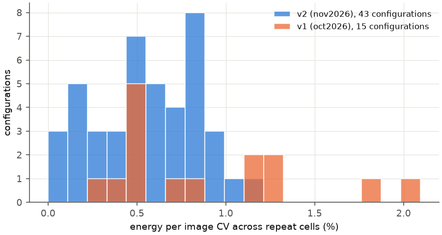
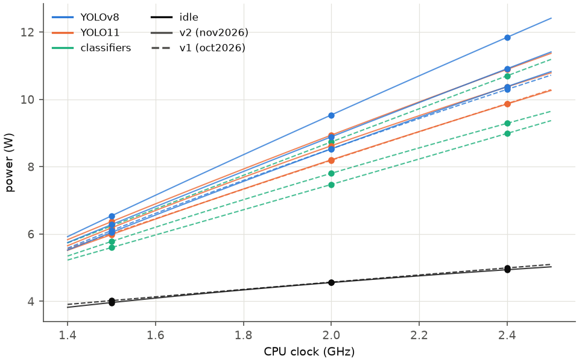
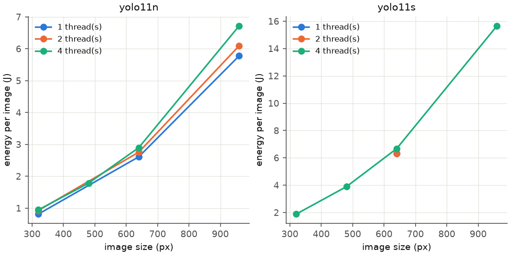
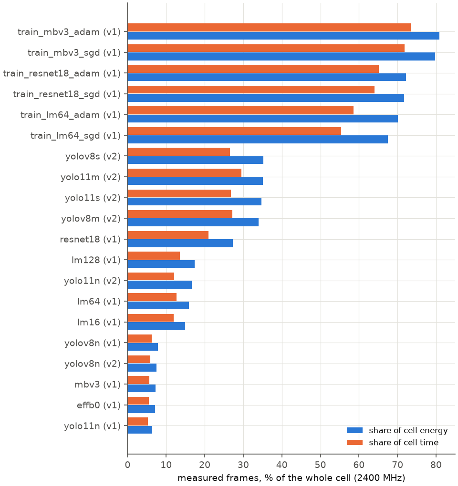
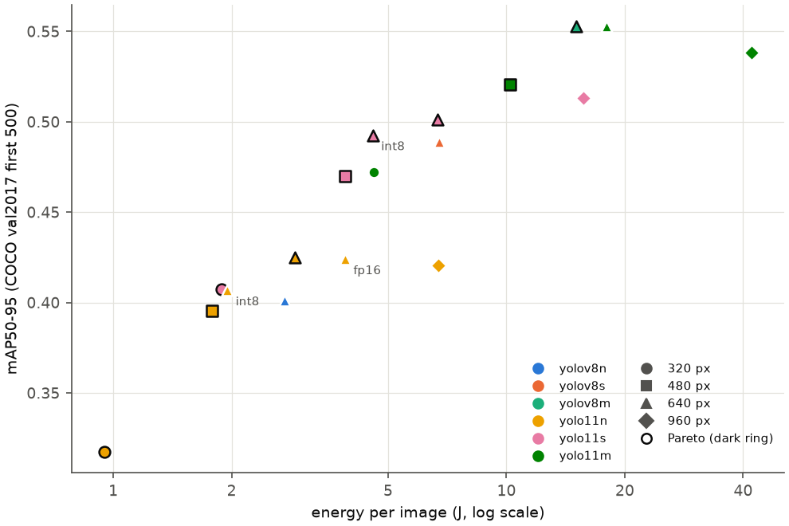

# Exploration report: Raspberry Pi 5 power datasets, configuration level

Descriptive only: nothing on this page fits or evaluates a predictor. All numbers use QC `primary` cells only (403 of 403 catalogue cells; dataset v2 (nov2026 rig, 179 cells); dataset v1 (oct2026 rig, 224 cells)). Energies are mJ per image (per frame / batch), latencies ms, power W. Every table states n and the dataset version; a configuration is one (model, precision, image size, batch, threads, clock, rig) cell group.

Mode A configurations: n = 58 configurations / 226 cells (dataset v1 (oct2026 rig) 80, v2 (nov2026 rig) 146 cells) (Mode A eligible, mode `forward`).

## 1. Repeatability

CV of energy per image across repeat cells, per configuration with at least two cells (58 configurations; 0 single-cell configurations excluded). n = 58 configurations / 226 cells (dataset v1 (oct2026 rig) 80, v2 (nov2026 rig) 146 cells).

| rig | n configurations | median CV % | p90 CV % | max CV % |
|---|---|---|---|---|
| nov2026 | 43 | 0.57 | 0.90 | 1.14 |
| oct2026 | 15 | 0.77 | 1.60 | 2.05 |
| all | 58 | 0.57 | 1.15 | 2.05 |

Configurations pool cells across the v2 families that share a command line (for example yolo11n, 640 px, 4 threads, 2400 MHz pools families A-input, D and ref), so a configuration's CV includes any family effect.

**Noise floor** (median energy CV over those 58 configurations, the figure used in every error table): **0.57 %**.

ICC(1,1) from a one-way random-effects ANOVA over configurations with >= 2 cells: `ICC = (MSB - MSW) / (MSB + (n0 - 1) MSW)` with `n0 = (N - sum n_i^2 / N) / (k - 1)` (unbalanced groups), k configurations, N cells, MSB and MSW the between- and within-configuration mean squares. On energy per image (58 configurations, 226 cells): ICC = 1.0000 (between SD 6180 mJ, within SD 39.6 mJ). On log energy: ICC = 1.0000 (1 - ICC = 4.9e-05; on raw energy 4.1e-05). The ICC is near 1 because the configurations span a 50-fold energy range; it says repeats separate configurations, while the CV above is the measure of repeat noise.

## 2. Clock scaling and idle power

`P(f) = P_static + k f^alpha`, f in GHz, fitted with `scipy.optimize.curve_fit` to the configuration means at 1500, 2000 and 2400 MHz (per base model at 640 px for YOLO / 224 px for classifiers, 4 threads, batch 1, fp32, fan full; and for idle power per rig). **Three points and three parameters: the free fit is exact by construction, descriptive only**, no in-sample claim. A negative `P_static` is non-physical; the second fit restricts `0 <= P_static <= min P` and its residual shows what that costs. `n_cfg`/`n_cells` count the three clock configurations and their cells.

| series | kind | rig | n_cfg | n_cells | fit | P_static | k | alpha | max_abs_resid | converged | at_bound |
|---|---|---|---|---|---|---|---|---|---|---|---|
| effb0 | forward power | oct2026 | 3 | 16 | free | -4.458 | 7.938 | 0.627 | 0.000 | yes | no |
| effb0 | forward power | oct2026 | 3 | 16 | P_static in [0, min P] | 0.000 | 3.861 | 1.006 | 0.050 | yes | yes |
| mbv3 | forward power | oct2026 | 3 | 16 | free | 0.266 | 3.488 | 1.047 | 0.000 | yes | no |
| mbv3 | forward power | oct2026 | 3 | 16 | P_static in [0, min P] | 0.266 | 3.488 | 1.047 | 0.000 | yes | no |
| resnet18 | forward power | oct2026 | 3 | 16 | free | -1.839 | 5.531 | 0.935 | 0.000 | yes | no |
| resnet18 | forward power | oct2026 | 3 | 16 | P_static in [0, min P] | 0.000 | 3.937 | 1.144 | 0.035 | yes | yes |
| yolo11m | forward power | nov2026 | 3 | 11 | free | -3.910 | 7.503 | 0.776 | 0.000 | yes | no |
| yolo11m | forward power | nov2026 | 3 | 11 | P_static in [0, min P] | 0.000 | 4.037 | 1.137 | 0.061 | yes | yes |
| yolo11n | forward power | nov2026 | 3 | 18 | free | -3.861 | 7.392 | 0.707 | 0.000 | yes | no |
| yolo11n | forward power | nov2026 | 3 | 18 | P_static in [0, min P] | 0.000 | 3.912 | 1.059 | 0.051 | yes | yes |
| yolo11n | forward power | oct2026 | 3 | 16 | free | -1.923 | 5.635 | 0.844 | 0.000 | yes | no |
| yolo11n | forward power | oct2026 | 3 | 16 | P_static in [0, min P] | 0.000 | 3.932 | 1.054 | 0.030 | yes | yes |
| yolo11s | forward power | nov2026 | 3 | 11 | free | -8.459 | 11.786 | 0.535 | 0.000 | yes | no |
| yolo11s | forward power | nov2026 | 3 | 11 | P_static in [0, min P] | 0.000 | 3.999 | 1.094 | 0.088 | yes | yes |
| yolov8m | forward power | nov2026 | 3 | 11 | free | -4.534 | 7.901 | 0.833 | 0.000 | yes | no |
| yolov8m | forward power | nov2026 | 3 | 11 | P_static in [0, min P] | 0.000 | 3.959 | 1.256 | 0.084 | yes | yes |
| yolov8n | forward power | nov2026 | 3 | 9 | free | -5.111 | 8.410 | 0.698 | 0.000 | yes | no |
| yolov8n | forward power | nov2026 | 3 | 9 | P_static in [0, min P] | 0.000 | 3.831 | 1.143 | 0.072 | yes | yes |
| yolov8n | forward power | oct2026 | 3 | 16 | free | -6.945 | 10.260 | 0.593 | 0.000 | yes | no |
| yolov8n | forward power | oct2026 | 3 | 16 | P_static in [0, min P] | 0.000 | 3.925 | 1.106 | 0.081 | yes | yes |
| yolov8s | forward power | nov2026 | 3 | 11 | free | -2.945 | 6.495 | 0.866 | 0.000 | yes | no |
| yolov8s | forward power | nov2026 | 3 | 11 | P_static in [0, min P] | 0.000 | 3.925 | 1.171 | 0.053 | yes | yes |
| idle | idle power | nov2026 | 3 | 163 | free | -37.078 | 40.219 | 0.050 | 0.005 | yes | yes |
| idle | idle power | nov2026 | 3 | 163 | P_static in [0, min P] | 0.000 | 3.285 | 0.468 | 0.020 | yes | yes |
| idle | idle power | oct2026 | 3 | 224 | free | 2.012 | 1.431 | 0.839 | 0.000 | yes | no |
| idle | idle power | oct2026 | 3 | 224 | P_static in [0, min P] | 2.012 | 1.431 | 0.839 | 0.000 | yes | no |

curve_fit did not converge for: none (all fits converged).

Forward power, free fits: P_static < 0 in 10 of 11 series, alpha 0.54-1.05; restricted fits: P_static = 0 in 10, alpha 1.01-1.26, worst residual 0.088 W. Idle power rises more slowly than that (see `alpha` of the idle rows); the free idle fit on the v2 rig sits on the alpha bound, so its parameters are not interpretable.

Idle power (median `baseline_W` over QC-primary cells of any workload) by rig, clock (or `ondemand`) and fan mode; n = 403 cells (dataset v1 (oct2026 rig) 224, v2 (nov2026 rig) 179 cells) contribute one baseline each.

| rig | cpu_key | fan_mode | idle W (median) | n cells | IQR W |
|---|---|---|---|---|---|
| nov2026 | 1500 | full | 3.962 | 21 | 0.031 |
| nov2026 | 2000 | full | 4.564 | 21 | 0.061 |
| nov2026 | 2400 | auto | 4.271 | 3 | 0.034 |
| nov2026 | 2400 | full | 4.937 | 121 | 0.102 |
| nov2026 | 2400 | off | 3.955 | 3 | 0.006 |
| nov2026 | ondemand | full | 4.123 | 10 | 0.023 |
| oct2026 | 1500 | full | 4.023 | 42 | 0.037 |
| oct2026 | 2000 | full | 4.571 | 42 | 0.062 |
| oct2026 | 2400 | full | 4.994 | 140 | 0.083 |

## 3. Rig shift: `ref` (v2, nov2026) against its v1 (oct2026) twin

Same base model, 640 px, 4 threads, batch 1, fp32, same clock. Means over the cells of each side; `%` columns are `ref / v1 - 1`; `se %` is the standard error of the energy difference implied by the two sides' CVs. 6 configuration pairs, 50 cells (ref cells = dataset v2 family `ref`; v1 cells = dataset v1).

| base_model | cpu_mhz | n_v1 | n_ref | energy_v1 | energy_ref | energy % | se % | latency_v1 | latency_ref | latency % | power_v1 | power_ref | power % |
|---|---|---|---|---|---|---|---|---|---|---|---|---|---|
| yolo11n | 1500 | 3 | 3 | 2188 | 2181 | -0.33 | 0.59 | 364 | 364.5 | +0.13 | 6.012 | 5.984 | -0.46 |
| yolo11n | 2000 | 3 | 3 | 2598 | 2592 | -0.21 | 0.37 | 317.1 | 316 | -0.35 | 8.193 | 8.204 | +0.14 |
| yolo11n | 2400 | 10 | 3 | 2873 | 2884 | +0.36 | 0.33 | 291 | 291 | +0.01 | 9.876 | 9.91 | +0.35 |
| yolov8n | 1500 | 3 | 3 | 2083 | 2034 | -2.37 | 1.08 | 341.3 | 336.2 | -1.49 | 6.104 | 6.049 | -0.89 |
| yolov8n | 2000 | 3 | 3 | 2448 | 2450 | +0.06 | 0.39 | 287 | 287.2 | +0.08 | 8.531 | 8.53 | -0.01 |
| yolov8n | 2400 | 10 | 3 | 2701 | 2721 | +0.76 | 0.27 | 262.2 | 262.1 | -0.04 | 10.3 | 10.38 | +0.80 |

Energy shift ranges from -2.37 % to +0.76 % (latency -1.49 to +0.13 %, power -0.89 to +0.80 %); noise floor 0.57 %.

## 4. Interactions

### 4.1 Threads x image size

Energy per image (mJ), 2400 MHz, batch 1, fp32, dataset v2 (nov2026): n = 16 configurations / 59 cells (dataset v2 (nov2026 rig) 59 cells).

**yolo11n** energy (mJ):

| threads | 320 | 480 | 640 | 960 |
|---|---|---|---|---|
| 1 | 814 |  | 2611 | 5779 |
| 2 | 927 |  | 2756 | 6095 |
| 4 | 947 | 1784 | 2899 | 6721 |

**yolo11n** % against 4 threads at the same size:

| threads | 320 | 480 | 640 | 960 |
|---|---|---|---|---|
| 1 | -14.1 |  | -9.9 | -14.0 |
| 2 | -2.1 |  | -4.9 | -9.3 |
| 4 | +0.0 | +0.0 | +0.0 | +0.0 |

**yolo11s** energy (mJ):

| threads | 320 | 480 | 640 | 960 |
|---|---|---|---|---|
| 1 |  |  | 6308 |  |
| 2 |  |  | 6308 |  |
| 4 | 1884 | 3890 | 6671 | 15665 |

**yolo11s** % against 4 threads at the same size:

| threads | 320 | 480 | 640 | 960 |
|---|---|---|---|---|
| 1 |  |  | -5.4 |  |
| 2 |  |  | -5.4 |  |
| 4 | +0.0 | +0.0 | +0.0 | +0.0 |

yolo11n at 320 px: 1 thread uses 14.1 % less energy per image than 4 threads (814 mJ; latency 113 ms).

### 4.2 Batch

Per-image energy, yolo11n at 640 px, 4 threads, 2400 MHz, fp32, dataset v2: n = 4 configurations / 21 cells (dataset v2 (nov2026 rig) 21 cells).

| base_model | batch | energy_mJ | latency_ms | mean_P_W | n_cells | pct_vs_batch1 |
|---|---|---|---|---|---|---|
| yolo11n | 1 | 2899 | 293.9 | 9.864 | 12 | +0.00 |
| yolo11n | 2 | 2865 | 291.1 | 9.842 | 3 | -1.16 |
| yolo11n | 4 | 2848 | 290.8 | 9.795 | 3 | -1.75 |
| yolo11n | 8 | 2839 | 285.8 | 9.931 | 3 | -2.08 |

### 4.3 INT8 and FP16 against FP32

Ratio of the reduced-precision configuration over the matching FP32 configuration (same model, size, batch, threads, clock, rig); 5 pairs, n = 9 configurations / 38 cells (dataset v2 (nov2026 rig) 38 cells).

| variant | precision | base_model | imgsz | cpu_mhz | n_cells | n_cells_fp32 | energy_ratio | latency_ratio | power_ratio |
|---|---|---|---|---|---|---|---|---|---|
| yolo11n_fp16 | fp16 | yolo11n | 640 | 2400 | 3 | 12 | 1.341 | 1.290 | 1.039 |
| yolo11n_int8s | int8 | yolo11n | 640 | 1500 | 3 | 3 | 0.793 | 0.853 | 0.931 |
| yolo11n_int8s | int8 | yolo11n | 640 | 2000 | 3 | 3 | 0.718 | 0.763 | 0.941 |
| yolo11n_int8s | int8 | yolo11n | 640 | 2400 | 3 | 12 | 0.673 | 0.704 | 0.956 |
| yolo11s_int8s | int8 | yolo11s | 640 | 2400 | 3 | 5 | 0.686 | 0.746 | 0.919 |

## 5. Phase and step shares

Per workload (`model_key`), averaged over QC-primary plain cells at 2400 MHz (fan full, 4 threads, fp32; batch 1 at 640 px for YOLO / 224 px for classifiers; LM and training at their only configuration): n = 172 cells (dataset v1 (oct2026 rig) 140, v2 (nov2026 rig) 32 cells). Entries are `energy % / time %` of the whole cell. Phase groups: `first` = first:* cold calls, `sync` = sync:*, `baseline` = baseline_A/B, `bench` = every bench:* microbenchmark phase, `measured` = the measured mode phases (forward / prefill+decode / train), `other` = idle.

| model_key | rig | n_cells | load_weights | first | warmup | sync | baseline | measured | gap | serve | bench | other |
|---|---|---|---|---|---|---|---|---|---|---|---|---|
| effb0 | oct2026 | 10 | 0.3 / 0.4 | 0.1 / 0.1 | 0.4 / 0.3 | 0.8 / 0.9 | 0.8 / 1.2 | 7.1 / 5.6 | 21.7 / 31.6 | 0.7 / 0.8 | 68.0 / 59.2 | 0.0 / 0.0 |
| lm128 | oct2026 | 10 | 0.0 / 0.0 | 0.0 / 0.0 | 0.5 / 0.6 | 9.5 / 9.4 | 8.7 / 11.4 | 17.4 / 13.6 | 23.3 / 30.5 | 4.4 / 5.6 | 36.2 / 28.9 | 0.1 / 0.1 |
| lm16 | oct2026 | 10 | 0.0 / 0.0 | 0.0 / 0.0 | 0.5 / 0.5 | 9.8 / 9.6 | 9.0 / 11.6 | 14.9 / 11.9 | 24.2 / 31.1 | 4.5 / 5.7 | 37.0 / 29.5 | 0.1 / 0.1 |
| lm64 | oct2026 | 10 | 0.0 / 0.0 | 0.0 / 0.0 | 0.5 / 0.5 | 9.7 / 9.5 | 8.9 / 11.6 | 15.9 / 12.7 | 23.7 / 30.7 | 4.4 / 5.6 | 36.8 / 29.4 | 0.1 / 0.1 |
| mbv3 | oct2026 | 10 | 0.4 / 0.4 | 0.0 / 0.0 | 0.2 / 0.1 | 1.0 / 1.0 | 0.9 / 1.3 | 7.3 / 5.7 | 22.1 / 31.2 | 0.5 / 0.7 | 67.6 / 59.4 | 0.0 / 0.0 |
| resnet18 | oct2026 | 10 | 1.1 / 1.4 | 0.2 / 0.2 | 1.0 / 0.8 | 2.4 / 3.0 | 2.3 / 3.7 | 27.2 / 20.9 | 14.6 / 23.7 | 2.0 / 2.5 | 49.3 / 43.7 | 0.0 / 0.0 |
| train_lm64_adam | oct2026 | 10 | 3.6 / 4.7 | 0.1 / 0.1 | 0.8 / 1.0 | 13.0 / 15.8 | 12.3 / 19.7 | 70.1 / 58.6 | - | - | - | 0.1 / 0.1 |
| train_lm64_sgd | oct2026 | 10 | 3.9 / 5.1 | 0.1 / 0.1 | 0.8 / 1.0 | 14.2 / 17.1 | 13.4 / 21.2 | 67.5 / 55.4 | - | - | - | 0.1 / 0.1 |
| train_mbv3_adam | oct2026 | 10 | 2.5 / 3.5 | 0.6 / 0.6 | 2.9 / 2.8 | 6.7 / 8.7 | 6.4 / 10.9 | 80.9 / 73.5 | - | - | - | 0.0 / 0.1 |
| train_mbv3_sgd | oct2026 | 10 | 2.6 / 3.7 | 0.6 / 0.6 | 2.9 / 2.8 | 7.1 / 9.2 | 6.9 / 11.7 | 79.8 / 71.9 | - | - | - | 0.0 / 0.1 |
| train_resnet18_adam | oct2026 | 10 | 2.4 / 3.8 | 2.4 / 2.2 | 12.1 / 11.2 | 5.6 / 7.9 | 5.2 / 9.8 | 72.3 / 65.2 | - | - | - | 0.0 / 0.1 |
| train_resnet18_sgd | oct2026 | 10 | 2.6 / 4.0 | 2.3 / 2.0 | 12.0 / 11.0 | 5.9 / 8.4 | 5.6 / 10.5 | 71.7 / 64.0 | - | - | - | 0.0 / 0.1 |
| yolo11m | nov2026 | 5 | 9.3 / 17.3 | 1.7 / 1.4 | 16.8 / 14.2 | 2.2 / 3.0 | 2.1 / 3.7 | 35.1 / 29.5 | 3.5 / 5.5 | 18.2 / 15.8 | 11.2 / 9.5 | 0.0 / 0.0 |
| yolo11n | nov2026 | 9 | 15.8 / 22.2 | 0.5 / 0.4 | 4.9 / 3.5 | 3.7 / 3.8 | 3.4 / 4.7 | 16.6 / 12.1 | 11.0 / 17.0 | 6.3 / 5.4 | 37.7 / 30.8 | 0.0 / 0.0 |
| yolo11n | oct2026 | 10 | 0.1 / 0.1 | 0.1 / 0.1 | 1.0 / 0.9 | 0.8 / 1.0 | 0.8 / 1.2 | 6.4 / 5.3 | 20.3 / 31.8 | 1.4 / 1.4 | 69.2 / 58.3 | 0.0 / 0.0 |
| yolo11s | nov2026 | 5 | 16.3 / 26.2 | 1.1 / 0.9 | 11.1 / 8.7 | 3.8 / 4.5 | 3.6 / 5.6 | 34.7 / 26.8 | 3.7 / 5.9 | 12.8 / 10.9 | 12.8 / 10.6 | 0.0 / 0.0 |
| yolov8m | nov2026 | 5 | 10.8 / 20.5 | 1.6 / 1.3 | 16.3 / 13.1 | 2.6 / 3.5 | 2.4 / 4.4 | 34.0 / 27.2 | 3.3 / 5.4 | 17.8 / 14.9 | 11.2 / 9.5 | 0.0 / 0.0 |
| yolov8n | nov2026 | 3 | 4.3 / 7.0 | 0.1 / 0.1 | 1.2 / 1.0 | 1.0 / 1.2 | 0.9 / 1.5 | 7.5 / 5.9 | 18.3 / 28.9 | 1.6 / 1.6 | 64.9 / 52.8 | 0.0 / 0.0 |
| yolov8n | oct2026 | 10 | 0.1 / 0.1 | 0.1 / 0.1 | 1.3 / 1.0 | 1.0 / 1.3 | 1.0 / 1.6 | 7.8 / 6.3 | 19.6 / 31.0 | 1.7 / 1.7 | 67.4 / 56.9 | 0.0 / 0.0 |
| yolov8s | nov2026 | 5 | 16.3 / 27.0 | 1.1 / 0.9 | 11.2 / 8.6 | 3.9 / 4.6 | 3.6 / 5.8 | 35.2 / 26.6 | 3.5 / 5.5 | 13.0 / 10.9 | 12.2 / 10.1 | 0.0 / 0.0 |

Within the measured frames (iter >= 1), share of frame energy / time by step. A `profiler` step, if a frame has one, would be its own column; `non-forward E %` is the energy outside the forward step (the pre/post-processing discount for image workloads).

| model_key | rig | n_cells | preprocess | forward | postprocess | dataload | zero_grad | loss | backward | optimizer_step | (none) | non-forward E % |
|---|---|---|---|---|---|---|---|---|---|---|---|---|
| effb0 | oct2026 | 10 | 0.9 / 0.9 | 99.0 / 98.9 | 0.1 / 0.1 | - | - | - | - | - | 0.1 / 0.1 | 1.0 |
| lm128 | oct2026 | 10 | 1.0 / 1.1 | 94.0 / 93.6 | 3.0 / 3.1 | - | - | - | - | - | 2.0 / 2.2 | 6.0 |
| lm16 | oct2026 | 10 | 1.2 / 1.3 | 93.1 / 93.1 | 3.2 / 3.2 | - | - | - | - | - | 2.4 / 2.4 | 6.9 |
| lm64 | oct2026 | 10 | 1.2 / 1.2 | 93.4 / 93.2 | 3.2 / 3.2 | - | - | - | - | - | 2.3 / 2.3 | 6.6 |
| mbv3 | oct2026 | 10 | 3.1 / 3.1 | 96.4 / 96.4 | 0.3 / 0.3 | - | - | - | - | - | 0.2 / 0.2 | 3.6 |
| resnet18 | oct2026 | 10 | 1.1 / 1.3 | 98.7 / 98.5 | 0.1 / 0.1 | - | - | - | - | - | 0.1 / 0.1 | 1.3 |
| train_lm64_adam | oct2026 | 10 | - | 31.9 / 31.8 | - | 0.4 / 0.6 | 1.0 / 1.3 | 2.3 / 2.2 | 48.2 / 45.2 | 15.2 / 17.5 | 1.1 / 1.4 | 68.1 |
| train_lm64_sgd | oct2026 | 10 | - | 37.1 / 37.1 | - | 0.4 / 0.6 | 0.8 / 1.2 | 2.5 / 2.5 | 52.8 / 49.4 | 5.2 / 7.6 | 1.1 / 1.5 | 62.9 |
| train_mbv3_adam | oct2026 | 10 | - | 33.1 / 34.2 | - | 1.2 / 1.3 | 0.6 / 0.7 | 0.0 / 0.0 | 53.2 / 50.9 | 11.8 / 12.7 | 0.1 / 0.2 | 66.9 |
| train_mbv3_sgd | oct2026 | 10 | - | 35.7 / 36.8 | - | 1.3 / 1.5 | 0.7 / 0.8 | 0.0 / 0.0 | 57.4 / 55.3 | 4.5 / 5.2 | 0.3 / 0.4 | 64.3 |
| train_resnet18_adam | oct2026 | 10 | - | 19.0 / 17.6 | - | 0.2 / 0.3 | 0.5 / 0.6 | 0.0 / 0.0 | 68.1 / 66.9 | 12.2 / 14.6 | 0.0 / 0.0 | 81.0 |
| train_resnet18_sgd | oct2026 | 10 | - | 20.3 / 19.1 | - | 0.2 / 0.3 | 0.5 / 0.7 | 0.0 / 0.0 | 73.2 / 73.1 | 5.7 / 6.7 | 0.0 / 0.0 | 79.7 |
| yolo11m | nov2026 | 5 | 0.2 / 0.2 | 99.7 / 99.6 | 0.1 / 0.2 | - | - | - | - | - | 0.0 / 0.1 | 0.3 |
| yolo11n | nov2026 | 9 | 1.2 / 1.4 | 97.7 / 97.0 | 1.0 / 1.4 | - | - | - | - | - | 0.1 / 0.1 | 2.3 |
| yolo11n | oct2026 | 10 | 1.1 / 1.4 | 98.0 / 97.6 | 0.7 / 0.9 | - | - | - | - | - | 0.1 / 0.2 | 2.0 |
| yolo11s | nov2026 | 5 | 0.5 / 0.6 | 99.1 / 98.9 | 0.3 / 0.4 | - | - | - | - | - | 0.1 / 0.1 | 0.9 |
| yolov8m | nov2026 | 5 | 0.2 / 0.3 | 99.6 / 99.5 | 0.1 / 0.2 | - | - | - | - | - | 0.0 / 0.0 | 0.4 |
| yolov8n | nov2026 | 3 | 1.1 / 1.4 | 98.1 / 97.6 | 0.8 / 0.9 | - | - | - | - | - | 0.0 / 0.0 | 1.9 |
| yolov8n | oct2026 | 10 | 1.1 / 1.4 | 98.1 / 97.6 | 0.8 / 1.0 | - | - | - | - | - | 0.0 / 0.0 | 1.9 |
| yolov8s | nov2026 | 5 | 0.5 / 0.6 | 99.1 / 98.8 | 0.3 / 0.4 | - | - | - | - | - | 0.1 / 0.1 | 0.9 |

<!-- EDA-TRACE-PART: sections 6-8 are spliced in here by the trace-level report -->

## 9. Energy against accuracy

YOLO configurations at 2400 MHz, 4 threads, batch 1, fp32 and INT8/FP16, with `map_reference` (mAP on the first 500 COCO val2017 images, measured on the Pi, constant per model variant and image size). v1 classifiers have random weights and v1 cells carry no mAP, so only dataset v2 appears. n = 18 configurations / 71 cells (dataset v2 (nov2026 rig) 71 cells). `pareto` = no other configuration is cheaper and at least as accurate.

| base_model | variant | precision | imgsz | n_cells | map50_95 | map50 | energy_mJ | latency_ms | pareto |
|---|---|---|---|---|---|---|---|---|---|
| yolo11n | yolo11n | fp32 | 320 | 3 | 0.3175 | 0.4474 | 947 | 100 | yes |
| yolo11n | yolo11n | fp32 | 480 | 3 | 0.3953 | 0.5376 | 1784 | 183 | yes |
| yolo11s | yolo11s | fp32 | 320 | 3 | 0.4075 | 0.5611 | 1884 | 188 | yes |
| yolo11n | yolo11n_int8s | int8 | 640 | 3 | 0.4067 | 0.5619 | 1950 | 207 | no |
| yolov8n | yolov8n | fp32 | 640 | 3 | 0.4012 | 0.5566 | 2721 | 262 | no |
| yolo11n | yolo11n | fp32 | 640 | 12 | 0.4248 | 0.5798 | 2899 | 294 | yes |
| yolo11n | yolo11n_fp16 | fp16 | 640 | 3 | 0.4240 | 0.5792 | 3887 | 379 | no |
| yolo11s | yolo11s | fp32 | 480 | 3 | 0.4699 | 0.6323 | 3890 | 381 | yes |
| yolo11s | yolo11s_int8s | int8 | 640 | 3 | 0.4926 | 0.6585 | 4574 | 480 | yes |
| yolo11m | yolo11m | fp32 | 320 | 3 | 0.4721 | 0.6308 | 4596 | 432 | no |
| yolo11s | yolo11s | fp32 | 640 | 5 | 0.5013 | 0.6657 | 6671 | 643 | yes |
| yolo11n | yolo11n | fp32 | 960 | 3 | 0.4204 | 0.6045 | 6721 | 677 | no |
| yolov8s | yolov8s | fp32 | 640 | 5 | 0.4891 | 0.6517 | 6735 | 617 | no |
| yolo11m | yolo11m | fp32 | 480 | 3 | 0.5206 | 0.6763 | 10221 | 951 | yes |
| yolov8m | yolov8m | fp32 | 640 | 5 | 0.5529 | 0.7198 | 15045 | 1270 | yes |
| yolo11s | yolo11s | fp32 | 960 | 3 | 0.5133 | 0.6976 | 15665 | 1517 | no |
| yolo11m | yolo11m | fp32 | 640 | 5 | 0.5528 | 0.7129 | 17998 | 1652 | no |
| yolo11m | yolo11m | fp32 | 960 | 3 | 0.5382 | 0.7187 | 42043 | 3867 | no |

## 10. MiniGPT and training workloads

### 10.1 MiniGPT energy per token

Prefill: energy per frame divided by `seq_len` (the prompt length in `run_meta`, 16 / 64 / 128 for lm16 / lm64 / lm128). Decode: a frame is one forward pass on one token without a KV cache, so one token. 18 groups; n = 48 cells (dataset v1 (oct2026 rig) 48 cells).

| model_key | mode | cpu_mhz | n_cells | tokens_per_frame | E_per_token_mJ | ms_per_token | mean_P_W | cv_pct |
|---|---|---|---|---|---|---|---|---|
| lm128 | decode | 1500 | 3 | 1 | 11.579 | 2.188 | 5.29 | 0.82 |
| lm128 | decode | 2000 | 3 | 1 | 12.044 | 1.680 | 7.17 | 1.66 |
| lm128 | decode | 2400 | 10 | 1 | 12.245 | 1.426 | 8.59 | 1.24 |
| lm128 | prefill | 1500 | 3 | 128 | 0.147 | 0.027 | 5.51 | 2.06 |
| lm128 | prefill | 2000 | 3 | 128 | 0.162 | 0.021 | 7.54 | 1.07 |
| lm128 | prefill | 2400 | 10 | 128 | 0.170 | 0.019 | 9.06 | 1.25 |
| lm16 | decode | 1500 | 3 | 1 | 11.245 | 2.123 | 5.30 | 0.72 |
| lm16 | decode | 2000 | 3 | 1 | 11.999 | 1.679 | 7.15 | 1.70 |
| lm16 | decode | 2400 | 10 | 1 | 12.226 | 1.418 | 8.62 | 1.27 |
| lm16 | prefill | 1500 | 3 | 16 | 0.837 | 0.158 | 5.31 | 1.47 |
| lm16 | prefill | 2000 | 3 | 16 | 0.889 | 0.125 | 7.13 | 0.39 |
| lm16 | prefill | 2400 | 10 | 16 | 0.928 | 0.109 | 8.53 | 2.36 |
| lm64 | decode | 1500 | 3 | 1 | 11.757 | 2.188 | 5.37 | 3.35 |
| lm64 | decode | 2000 | 3 | 1 | 12.226 | 1.717 | 7.12 | 2.08 |
| lm64 | decode | 2400 | 10 | 1 | 12.654 | 1.469 | 8.62 | 2.12 |
| lm64 | prefill | 1500 | 3 | 64 | 0.240 | 0.044 | 5.46 | 1.80 |
| lm64 | prefill | 2000 | 3 | 64 | 0.258 | 0.036 | 7.25 | 1.67 |
| lm64 | prefill | 2400 | 10 | 64 | 0.272 | 0.031 | 8.74 | 2.57 |

### 10.2 Training energy per step

One frame is one optimiser step on `batch` samples (synthetic data; frame 0 excluded). 18 groups; n = 96 cells (dataset v1 (oct2026 rig) 96 cells).

| workload | optimiser | cpu_mhz | n_cells | batch | E_step_mJ | ms_step | mean_P_W | cv_pct |
|---|---|---|---|---|---|---|---|---|
| lm64 | adam | 1500 | 3 | 8 | 96.2 | 16.6 | 5.80 | 0.63 |
| lm64 | adam | 2000 | 3 | 8 | 109.5 | 13.8 | 7.96 | 0.31 |
| lm64 | adam | 2400 | 10 | 8 | 119.6 | 12.5 | 9.59 | 1.45 |
| lm64 | sgd | 1500 | 3 | 8 | 85.9 | 14.8 | 5.79 | 0.38 |
| lm64 | sgd | 2000 | 3 | 8 | 98.9 | 12.3 | 8.01 | 0.95 |
| lm64 | sgd | 2400 | 10 | 8 | 106.4 | 11.1 | 9.61 | 1.03 |
| mbv3 | adam | 1500 | 3 | 8 | 1427.3 | 249.0 | 5.73 | 0.47 |
| mbv3 | adam | 2000 | 3 | 8 | 1653.8 | 211.0 | 7.84 | 1.34 |
| mbv3 | adam | 2400 | 10 | 8 | 1802.7 | 191.0 | 9.44 | 0.62 |
| mbv3 | sgd | 1500 | 3 | 8 | 1330.1 | 230.7 | 5.76 | 0.94 |
| mbv3 | sgd | 2000 | 3 | 8 | 1527.9 | 194.9 | 7.84 | 0.83 |
| mbv3 | sgd | 2400 | 10 | 8 | 1666.8 | 176.0 | 9.47 | 0.90 |
| resnet18 | adam | 1500 | 3 | 8 | 7200.8 | 1142.9 | 6.30 | 0.43 |
| resnet18 | adam | 2000 | 3 | 8 | 8712.5 | 1004.0 | 8.68 | 0.36 |
| resnet18 | adam | 2400 | 10 | 8 | 9815.5 | 942.2 | 10.42 | 0.61 |
| resnet18 | sgd | 1500 | 3 | 8 | 6795.3 | 1073.7 | 6.33 | 0.78 |
| resnet18 | sgd | 2000 | 3 | 8 | 8217.0 | 934.4 | 8.79 | 0.45 |
| resnet18 | sgd | 2400 | 10 | 8 | 9152.9 | 865.0 | 10.58 | 0.54 |
