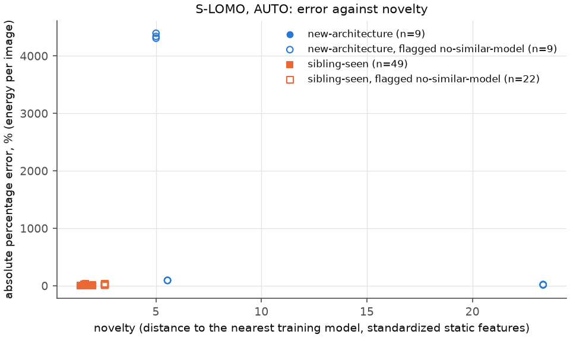
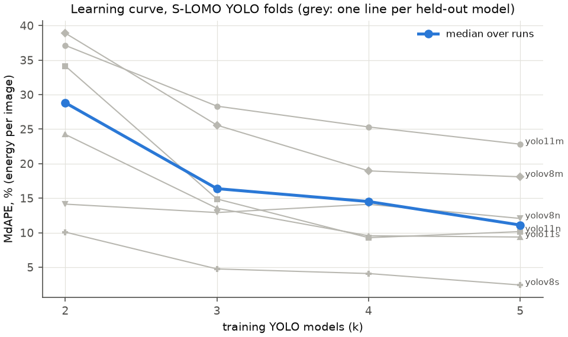
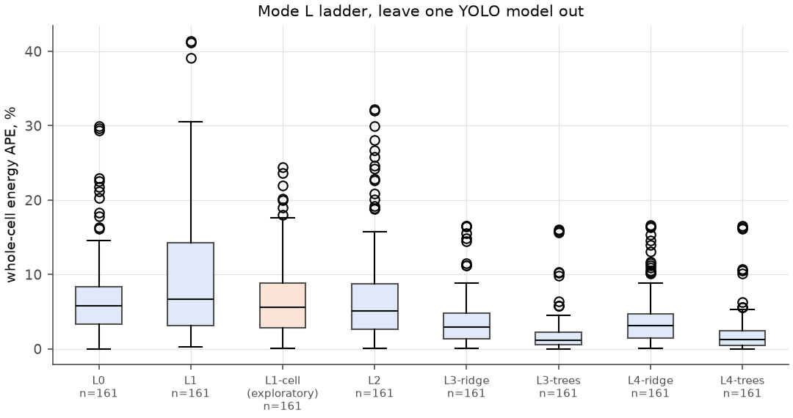
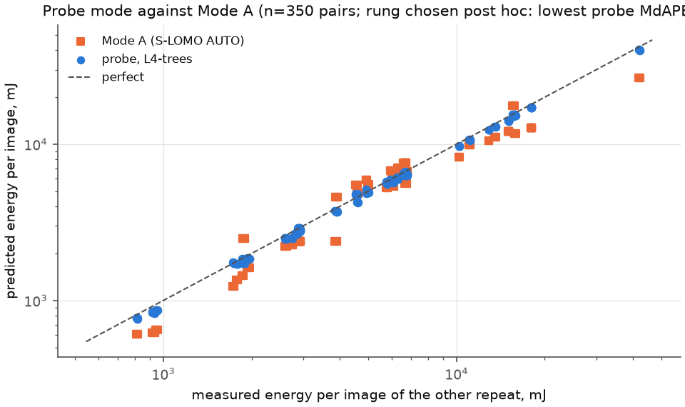

> **R1, the pre-registered analysis (frozen).** The post-review revision R2 (2026-11-24, exploratory) is summarised in [`r2/README.md`](r2/README.md); the measurement checks are in [`measurement_audit.md`](measurement_audit.md). This file is unchanged apart from this note; an exact copy is in `r1_frozen/`. Two top-level data files were regenerated under R2: `deploy_validation.csv` (gap scenario added) and `mode_a_configs.csv` (R2 columns added). Their R1 versions are `r1_frozen/deploy_validation.csv` and `r1_frozen/mode_a_configs.csv`.

# Results report: Mode A and Mode L

Generated by `cd analytics && uv run python cli.py report`. Sections follow the order of the protocol; each table is preceded by a line giving its split, target, n, dataset version(s) and run_id.

## 1. Headline claims

Every row names one split, one target, one metric, an interval and a run_id. Intervals are cluster-bootstrap 95 % (2000 resamples, seed 20261122; clusters are base models). Percentages are percent absolute error unless stated. Data: n = 58 configurations / 226 cells (dataset v1 (oct2026 rig) 80, v2 (nov2026 rig) 146 cells). Run `ad0ab1cdc1`, data hash `09890ae9fab4`. Nothing here is a lockbox result: the lockbox has not been collected.

*Split: S-LOMO. Target: energy_mJ. n = 58 configurations / 226 cells (dataset v1 (oct2026 rig) 80, v2 (nov2026 rig) 146 cells). run_id: `aa634083491146caa1898cb53dd5b2dc`. Noise floor (median repeat CV, configurations with at least 2 cells) 0.6 %.* H1 is the headline; H2 is its best-baseline comparator.

| id | claim | split | target | metric | estimate | 95 % CI | n | run_id | status |
|---|---|---|---|---|---|---|---|---|---|
| H1 | Mode A AUTO | S-LOMO | energy_mJ | MdAPE % | 17.5 | [13.8, 22.8] | 58 | aa634083491146caa1898cb53dd5b2dc | pre-registered headline |
| H2 | Mode A B3 log-linear | S-LOMO | energy_mJ | MdAPE % | 15.8 | [8.9, 41.6] | 58 | aa634083491146caa1898cb53dd5b2dc | best baseline (by MdAPE) |

### Mode L ladder (whole-cell energy APE; no single pre-registered rung)

Mode L is a ladder: no single rung is the pre-registered headline, so every rung is listed with the same metric and interval. Counter overhead: counters-off (`ref`) cells drew +0.320 W (+3.34 %) against the same 1 configuration with counters on (`reports/eda.md`, section 7.2; family, order and the counters switch are confounded, so this bounds the overhead only loosely). Perf was running in every v2 counter cell, so the overhead is inside every number here.

*Split: leave one YOLO base model out. Target: whole-cell energy. n = 161 held-out cells in 38 configurations and 5 folds (dataset v2, nov2026 rig). run_id: `acc4f1bf2b524febb2565e1d8fe3e79b`. Mode A's energy noise floor (median repeat CV, configurations with at least 2 cells) 0.6 %, reused here as the indistinguishability margin.* Median whole-cell energy APE per rung over held-out cells; `L1-cell` is exploratory (see section 9).

| rung | split | target | metric | estimate | 95 % CI | n | n configurations | run_id | status |
|---|---|---|---|---|---|---|---|---|---|
| L0 | leave one YOLO model out | whole-cell energy | MdAPE % | 5.8 | [3.4, 7.4] | 161 | 38 | acc4f1bf2b524febb2565e1d8fe3e79b | pre-registered rung |
| L1 | leave one YOLO model out | whole-cell energy | MdAPE % | 6.7 | [4.7, 13.2] | 161 | 38 | acc4f1bf2b524febb2565e1d8fe3e79b | pre-registered rung |
| L1-cell (exploratory) | leave one YOLO model out | whole-cell energy | MdAPE % | 5.6 | [4.2, 6.8] | 161 | 38 | acc4f1bf2b524febb2565e1d8fe3e79b | exploratory (added after a scored fold) |
| L2 | leave one YOLO model out | whole-cell energy | MdAPE % | 5.1 | [4.3, 8.7] | 161 | 38 | acc4f1bf2b524febb2565e1d8fe3e79b | pre-registered rung |
| L3-ridge | leave one YOLO model out | whole-cell energy | MdAPE % | 2.9 | [2.0, 4.1] | 161 | 38 | acc4f1bf2b524febb2565e1d8fe3e79b | pre-registered rung |
| L3-trees | leave one YOLO model out | whole-cell energy | MdAPE % | 1.2 | [0.8, 1.5] | 161 | 38 | acc4f1bf2b524febb2565e1d8fe3e79b | pre-registered rung |
| L4-ridge | leave one YOLO model out | whole-cell energy | MdAPE % | 3.1 | [2.2, 4.3] | 161 | 38 | acc4f1bf2b524febb2565e1d8fe3e79b | pre-registered rung |
| L4-trees | leave one YOLO model out | whole-cell energy | MdAPE % | 1.2 | [0.6, 1.5] | 161 | 38 | acc4f1bf2b524febb2565e1d8fe3e79b | pre-registered rung |

### Findings at a glance (positive and negative)

- Mode A, S-LOMO energy: M1 ridge against the best baseline (B3 log-linear): **not significant** (median paired APE difference +4.97 pp, Holm p = 0.951, n = 58; run_id `aa634083491146caa1898cb53dd5b2dc`).
- Mode A, S-LOMO energy: M2 trees against the best baseline (B3 log-linear): **indistinguishable (below noise floor)** (median paired APE difference +0.39 pp, Holm p = 0.951, n = 58; run_id `aa634083491146caa1898cb53dd5b2dc`).
- Mode A, S-LOMO energy: M3 factored against the best baseline (B3 log-linear): **not significant** (median paired APE difference -1.86 pp, Holm p = 0.951, n = 58; run_id `aa634083491146caa1898cb53dd5b2dc`).
- Mode A, S-LOMO energy: AUTO against the best baseline (B3 log-linear): **not significant** (median paired APE difference +4.97 pp, Holm p = 0.951, n = 58; run_id `aa634083491146caa1898cb53dd5b2dc`).
- Mode A, S-LOMO energy: AUTO 90 % interval coverage 0.91 against the nominal 0.90, n = 58; coarse with 9 models.
- Mode A, S-LOMO energy: 31 of 58 AUTO predictions carry the `no-similar-model` flag.
- Mode L, whole-cell energy: L1 against L0: **not significant** (median paired APE difference of the per-configuration mean APE +1.09 pp, Holm p = 0.148, n = 38 configurations (161 cells); run_id `acc4f1bf2b524febb2565e1d8fe3e79b`).
- Mode L, whole-cell energy: L1-cell (exploratory) against L0: **not significant** (median paired APE difference of the per-configuration mean APE -0.62 pp, Holm p = 1, n = 38 configurations (161 cells); run_id `acc4f1bf2b524febb2565e1d8fe3e79b`).
- Mode L, whole-cell energy: L2 against L0: **indistinguishable (below noise floor)** (median paired APE difference of the per-configuration mean APE -0.40 pp, Holm p = 1, n = 38 configurations (161 cells); run_id `acc4f1bf2b524febb2565e1d8fe3e79b`).
- Mode L, whole-cell energy: L3-ridge against L0: **better** (median paired APE difference of the per-configuration mean APE -2.86 pp, Holm p = 3.3e-05, n = 38 configurations (161 cells); run_id `acc4f1bf2b524febb2565e1d8fe3e79b`).
- Mode L, whole-cell energy: L3-trees against L0: **better** (median paired APE difference of the per-configuration mean APE -3.76 pp, Holm p = 2.55e-10, n = 38 configurations (161 cells); run_id `acc4f1bf2b524febb2565e1d8fe3e79b`).
- Mode L, whole-cell energy: L4-ridge against L0: **better** (median paired APE difference of the per-configuration mean APE -2.82 pp, Holm p = 0.000315, n = 38 configurations (161 cells); run_id `acc4f1bf2b524febb2565e1d8fe3e79b`).
- Mode L, whole-cell energy: L4-trees against L0: **better** (median paired APE difference of the per-configuration mean APE -3.90 pp, Holm p = 2.55e-10, n = 38 configurations (161 cells); run_id `acc4f1bf2b524febb2565e1d8fe3e79b`).
- Probe mode, L0: probe MdAPE 6.0 % against Mode A 18.0 % on the same pairs: **better** (median paired APE difference -12.26 pp, Holm p = 0.000109, n = 38 configurations, 350 pairs; run_id `acc4f1bf2b524febb2565e1d8fe3e79b`).
- Probe mode, L1: probe MdAPE 17.4 % against Mode A 18.0 % on the same pairs: **not significant** (median paired APE difference -1.90 pp, Holm p = 0.106, n = 38 configurations, 350 pairs; run_id `acc4f1bf2b524febb2565e1d8fe3e79b`).
- Probe mode, L1-cell (exploratory): probe MdAPE 13.8 % against Mode A 18.0 % on the same pairs: **not significant** (median paired APE difference -3.03 pp, Holm p = 0.106, n = 38 configurations, 350 pairs; run_id `acc4f1bf2b524febb2565e1d8fe3e79b`).
- Probe mode, L2: probe MdAPE 6.4 % against Mode A 18.0 % on the same pairs: **better** (median paired APE difference -11.69 pp, Holm p = 2.19e-05, n = 38 configurations, 350 pairs; run_id `acc4f1bf2b524febb2565e1d8fe3e79b`).
- Probe mode, L3-ridge: probe MdAPE 5.5 % against Mode A 18.0 % on the same pairs: **better** (median paired APE difference -12.36 pp, Holm p = 2.34e-08, n = 38 configurations, 350 pairs; run_id `acc4f1bf2b524febb2565e1d8fe3e79b`).
- Probe mode, L3-trees: probe MdAPE 4.3 % against Mode A 18.0 % on the same pairs: **better** (median paired APE difference -13.45 pp, Holm p = 1.11e-09, n = 38 configurations, 350 pairs; run_id `acc4f1bf2b524febb2565e1d8fe3e79b`).
- Probe mode, L4-ridge: probe MdAPE 5.6 % against Mode A 18.0 % on the same pairs: **better** (median paired APE difference -12.27 pp, Holm p = 3.89e-08, n = 38 configurations, 350 pairs; run_id `acc4f1bf2b524febb2565e1d8fe3e79b`).
- Probe mode, L4-trees: probe MdAPE 4.1 % against Mode A 18.0 % on the same pairs: **better** (median paired APE difference -13.45 pp, Holm p = 1.11e-09, n = 38 configurations, 350 pairs; run_id `acc4f1bf2b524febb2565e1d8fe3e79b`).

## 2. Mode A results by split and target

Candidates in protocol order: B0 median, B1 energy proportional to MACs per clock, B2 most similar seen model scaled by MACs, B3 log-linear OLS, M1 ridge, M2 gradient-boosted trees, M3 factored latency x power (energy only), AUTO (best of M1 to M3 by inner leave-one-model-out MdAPE). Every candidate, baselines included, has a 90 % prediction interval from its own inner leave-one-model-out residual quantiles, so coverage is reported for all of them. Coverage rests on few clusters and is coarse. Paired tests use absolute log errors per test configuration; "indistinguishable" means the median paired APE difference is below the noise floor.

### S-LOMO

leave one base model out (9 folds; YOLO folds `sibling-seen`, classifier folds `new-architecture`); the headline split.

#### energy_mJ

*Split: S-LOMO. Target: energy_mJ (energy per image, mJ). n = 58 configurations / 226 cells (dataset v1 (oct2026 rig) 80, v2 (nov2026 rig) 146 cells). run_id: `aa634083491146caa1898cb53dd5b2dc`. Noise floor (median repeat CV, configurations with at least 2 cells) 0.6 %.* Seed 20261122. Best baseline B3 log-linear; bootstrap clusters: base_model.

| candidate | n | MdAPE % [95 % CI] | MAPE % [95 % CI] | MAE mJ [95 % CI] | bias % [95 % CI] | coverage90 |
|---|---|---|---|---|---|---|
| B0 median | 58 | 74.7 [45.6, 137.4] | 150.4 [73.8, 308.5] | 4,042 [2,100, 7,894] | 38.2 [-58.6, 117.0] | 0.8793 |
| B1 MACs proportional | 58 | 33.2 [29.4, 66.6] | 39.5 [31.0, 57.1] | 2,195 [867.6, 4,756] | 0.5 [-31.6, 35.9] | 0.8276 |
| B2 nearest model | 58 | 28.9 [20.9, 38.9] | 51.7 [25.6, 121.8] | 1,365 [871.4, 2,291] | -20.7 [-29.6, 22.6] | 0.931 |
| B3 log-linear | 58 | 15.8 [8.9, 41.6] | 28.9 [15.6, 60.2] | 1,277 [460.5, 3,340] | -3.6 [-28.8, 36.5] | 0.8793 |
| M1 ridge | 58 | 18.1 [13.8, 28.9] | 246.4 [17.2, 1022.1] | 3,001 [542.7, 9,408] | -16.5 [-19.4, 12.7] | 0.8966 |
| M2 trees | 58 | 24.7 [6.1, 29.7] | 34.3 [16.4, 68.8] | 1,364 [463.5, 3,174] | -4.9 [-22.4, 26.4] | 0.7241 |
| M3 factored | 58 | 15.9 [11.8, 19.5] | 19.9 [13.0, 32.9] | 961.2 [420.2, 2,126] | -13.2 [-18.6, 11.8] | 0.9138 |
| AUTO | 58 | 17.5 [13.8, 22.8] | 245.7 [16.3, 1020.9] | 2,998 [537.1, 9,405] | -16.4 [-18.4, 13.1] | 0.9138 |

*Split: S-LOMO. Target: energy_mJ (energy per image, mJ). n = 58 configurations / 226 cells (dataset v1 (oct2026 rig) 80, v2 (nov2026 rig) 146 cells). run_id: `aa634083491146caa1898cb53dd5b2dc`. Noise floor (median repeat CV, configurations with at least 2 cells) 0.6 %.* Seed 20261122. Paired Wilcoxon against the best baseline, Holm-adjusted over the learned candidates.

| candidate | vs best baseline | n | median paired diff, abs log error | median paired diff, APE (pp) | Wilcoxon p | Holm p | verdict |
|---|---|---|---|---|---|---|---|
| M1 ridge | B3 log-linear | 58 | +0.0738 | +4.97 | 0.238 | 0.951 | not significant |
| M2 trees | B3 log-linear | 58 | +0.0040 | +0.39 | 0.73 | 0.951 | indistinguishable (below noise floor) |
| M3 factored | B3 log-linear | 58 | +0.0263 | -1.86 | 0.441 | 0.951 | not significant |
| AUTO | B3 log-linear | 58 | +0.0738 | +4.97 | 0.28 | 0.951 | not significant |

*Split: S-LOMO. Target: energy_mJ (energy per image, mJ). n = 58 configurations / 226 cells (dataset v1 (oct2026 rig) 80, v2 (nov2026 rig) 146 cells). run_id: `aa634083491146caa1898cb53dd5b2dc`. Noise floor (median repeat CV, configurations with at least 2 cells) 0.6 %.* Seed 20261122. By similarity class; n counts predictions.

| similarity class | candidate | n | MdAPE % | MAPE % | bias % | coverage90 |
|---|---|---|---|---|---|---|
| new-architecture | B0 median | 9 | 274.2 | 500.9 | 274.2 | 0.6667 |
| new-architecture | B1 MACs proportional | 9 | 74.3 | 68.5 | -74.3 | 0.3333 |
| new-architecture | B2 nearest model | 9 | 105.1 | 193.1 | 105.1 | 0.6667 |
| new-architecture | B3 log-linear | 9 | 58.0 | 88.5 | -37.5 | 0.3333 |
| new-architecture | M1 ridge | 9 | 94.9 | 1491.5 | -30.7 | 0.6667 |
| new-architecture | M2 trees | 9 | 114.0 | 112.1 | 114.0 | 0.3333 |
| new-architecture | M3 factored | 9 | 16.9 | 40.3 | -16.9 | 0.6667 |
| new-architecture | AUTO | 9 | 94.9 | 1487.8 | -16.9 | 0.6667 |
| sibling-seen | B0 median | 49 | 60.9 | 86.0 | 6.3 | 0.9184 |
| sibling-seen | B1 MACs proportional | 49 | 32.4 | 34.2 | 0.9 | 0.9184 |
| sibling-seen | B2 nearest model | 49 | 24.6 | 25.8 | -22.7 | 0.9796 |
| sibling-seen | B3 log-linear | 49 | 9.6 | 17.9 | -2.8 | 0.9796 |
| sibling-seen | M1 ridge | 49 | 17.0 | 17.7 | -16.2 | 0.9388 |
| sibling-seen | M2 trees | 49 | 22.5 | 20.0 | -6.1 | 0.7959 |
| sibling-seen | M3 factored | 49 | 15.5 | 16.2 | -11.2 | 0.9592 |
| sibling-seen | AUTO | 49 | 16.8 | 17.6 | -16.2 | 0.9592 |

*Split: S-LOMO. Target: energy_mJ (energy per image, mJ). n = 58 configurations / 226 cells (dataset v1 (oct2026 rig) 80, v2 (nov2026 rig) 146 cells). run_id: `aa634083491146caa1898cb53dd5b2dc`. Noise floor (median repeat CV, configurations with at least 2 cells) 0.6 %.* Seed 20261122. By base model.

| base model | similarity class | n | novelty | flagged | AUTO MdAPE % | B3 log-linear MdAPE % | AUTO bias % | AUTO coverage90 |
|---|---|---|---|---|---|---|---|---|
| effb0 | new-architecture | 3 | 5.007 | 3 | 4340.8 | 37.5 | 4340.8 | 1 |
| mbv3 | new-architecture | 3 | 23.351 | 3 | 16.9 | 58.0 | -16.9 | 1 |
| resnet18 | new-architecture | 3 | 5.552 | 3 | 94.9 | 171.5 | -94.9 | 0 |
| yolo11m | sibling-seen | 6 | 1.671 | 0 | 22.8 | 35.5 | -22.8 | 0.8333 |
| yolo11n | sibling-seen | 22 | 2.586 | 22 | 17.5 | 7.7 | -17.5 | 1 |
| yolo11s | sibling-seen | 9 | 1.591 | 0 | 13.8 | 8.9 | 13.8 | 0.8889 |
| yolov8m | sibling-seen | 3 | 1.573 | 0 | 18.1 | 3.8 | -18.1 | 1 |
| yolov8n | sibling-seen | 6 | 2.005 | 0 | 11.5 | 42.3 | 11.5 | 1 |
| yolov8s | sibling-seen | 3 | 1.410 | 0 | 2.4 | 13.5 | 2.4 | 1 |

*Split: S-LOMO. Target: energy_mJ (energy per image, mJ). n = 58 configurations / 226 cells (dataset v1 (oct2026 rig) 80, v2 (nov2026 rig) 146 cells). run_id: `aa634083491146caa1898cb53dd5b2dc`. Noise floor (median repeat CV, configurations with at least 2 cells) 0.6 %.* Seed 20261122. By precision, image size, threads, batch, clock and rig (fixed subgroups).

| factor | level | n | AUTO MdAPE % | AUTO bias % | B3 log-linear MdAPE % |
|---|---|---|---|---|---|
| precision | fp16 | 1 | 38.8 | -38.8 | 27.5 |
| precision | fp32 | 53 | 17.0 | -16.2 | 21.5 |
| precision | int8 | 4 | 21.7 | -19.9 | 5.1 |
| imgsz | 224 | 9 | 94.9 | -16.9 | 58.0 |
| imgsz | 320 | 5 | 31.4 | -25.6 | 25.6 |
| imgsz | 480 | 3 | 19.4 | -19.4 | 9.6 |
| imgsz | 640 | 36 | 16.7 | -16.2 | 7.8 |
| imgsz | 960 | 5 | 12.7 | -12.1 | 29.4 |
| threads | 1 | 4 | 12.3 | -12.3 | 13.0 |
| threads | 2 | 4 | 14.9 | -14.9 | 13.9 |
| threads | 4 | 50 | 18.0 | -16.5 | 18.3 |
| batch | 1 | 55 | 18.0 | -16.4 | 21.5 |
| batch | 2 | 1 | 17.0 | -17.0 | 1.7 |
| batch | 4 | 1 | 16.5 | -16.5 | 1.1 |
| batch | 8 | 1 | 16.2 | -16.2 | 0.7 |
| cpu_mhz | 1500 | 12 | 17.9 | -13.6 | 24.3 |
| cpu_mhz | 2000 | 12 | 18.1 | -17.5 | 24.3 |
| cpu_mhz | 2400 | 34 | 16.9 | -16.3 | 15.5 |
| rig | nov2026 | 43 | 17.4 | -16.4 | 9.6 |
| rig | oct2026 | 15 | 18.1 | -16.4 | 41.6 |

#### latency_ms

*Split: S-LOMO. Target: latency_ms (latency per image, ms). n = 58 configurations / 226 cells (dataset v1 (oct2026 rig) 80, v2 (nov2026 rig) 146 cells). run_id: `d8d7ac3750c442d292c0a01511667235`. Noise floor (median repeat CV, configurations with at least 2 cells) 0.2 %.* Seed 20261122. Best baseline B3 log-linear; bootstrap clusters: base_model.

| candidate | n | MdAPE % [95 % CI] | MAPE % [95 % CI] | MAE ms [95 % CI] | bias % [95 % CI] | coverage90 |
|---|---|---|---|---|---|---|
| B0 median | 58 | 58.1 [45.5, 104.7] | 127.8 [66.2, 272.0] | 414.5 [210.7, 820.3] | 25.1 [-60.2, 65.8] | 0.8793 |
| B1 MACs proportional | 58 | 39.7 [35.1, 76.6] | 48.0 [37.9, 69.9] | 308.6 [118.2, 693.1] | 3.2 [-33.5, 43.6] | 0.8448 |
| B2 nearest model | 58 | 31.7 [26.4, 41.9] | 59.5 [30.5, 138.5] | 188.6 [121.6, 315.7] | -27.2 [-32.8, 29.5] | 0.9483 |
| B3 log-linear | 58 | 16.8 [8.9, 47.8] | 30.4 [16.0, 64.1] | 144.8 [57.09, 364.0] | -4.6 [-31.5, 35.4] | 0.8966 |
| M1 ridge | 58 | 18.3 [12.6, 20.9] | 22.1 [14.2, 33.8] | 112.0 [51.64, 243.5] | -17.8 [-20.8, 9.8] | 0.8621 |
| M2 trees | 58 | 22.0 [5.9, 34.7] | 32.8 [16.1, 58.5] | 150.4 [52.80, 329.4] | -2.6 [-32.5, 16.8] | 0.8103 |
| AUTO | 58 | 18.3 [12.6, 20.9] | 22.1 [14.2, 33.8] | 112.0 [51.64, 243.5] | -17.8 [-20.8, 9.8] | 0.8621 |

*Split: S-LOMO. Target: latency_ms (latency per image, ms). n = 58 configurations / 226 cells (dataset v1 (oct2026 rig) 80, v2 (nov2026 rig) 146 cells). run_id: `d8d7ac3750c442d292c0a01511667235`. Noise floor (median repeat CV, configurations with at least 2 cells) 0.2 %.* Seed 20261122. Paired Wilcoxon against the best baseline, Holm-adjusted over the learned candidates.

| candidate | vs best baseline | n | median paired diff, abs log error | median paired diff, APE (pp) | Wilcoxon p | Holm p | verdict |
|---|---|---|---|---|---|---|---|
| M1 ridge | B3 log-linear | 58 | +0.0598 | -2.50 | 0.813 | 1 | not significant |
| M2 trees | B3 log-linear | 58 | +0.0350 | +4.69 | 0.656 | 1 | not significant |
| AUTO | B3 log-linear | 58 | +0.0598 | -2.50 | 0.813 | 1 | not significant |

*Split: S-LOMO. Target: latency_ms (latency per image, ms). n = 58 configurations / 226 cells (dataset v1 (oct2026 rig) 80, v2 (nov2026 rig) 146 cells). run_id: `d8d7ac3750c442d292c0a01511667235`. Noise floor (median repeat CV, configurations with at least 2 cells) 0.2 %.* Seed 20261122. By similarity class; n counts predictions.

| similarity class | candidate | n | MdAPE % | MAPE % | bias % | coverage90 |
|---|---|---|---|---|---|---|
| new-architecture | B0 median | 9 | 291.3 | 442.6 | 291.3 | 0.6667 |
| new-architecture | B1 MACs proportional | 9 | 76.6 | 73.5 | -76.5 | 0.2222 |
| new-architecture | B2 nearest model | 9 | 114.2 | 216.5 | 114.2 | 0.6667 |
| new-architecture | B3 log-linear | 9 | 57.3 | 93.5 | -38.5 | 0.4444 |
| new-architecture | M1 ridge | 9 | 22.9 | 43.6 | -22.9 | 0.6667 |
| new-architecture | M2 trees | 9 | 96.6 | 92.3 | 96.6 | 0.3333 |
| new-architecture | AUTO | 9 | 22.9 | 43.6 | -22.9 | 0.6667 |
| sibling-seen | B0 median | 49 | 55.1 | 70.0 | 6.0 | 0.9184 |
| sibling-seen | B1 MACs proportional | 49 | 38.2 | 43.3 | 5.6 | 0.9592 |
| sibling-seen | B2 nearest model | 49 | 29.4 | 30.7 | -27.6 | 1 |
| sibling-seen | B3 log-linear | 49 | 10.9 | 18.8 | -4.1 | 0.9796 |
| sibling-seen | M1 ridge | 49 | 18.0 | 18.1 | -16.8 | 0.898 |
| sibling-seen | M2 trees | 49 | 19.7 | 21.9 | -8.4 | 0.898 |
| sibling-seen | AUTO | 49 | 18.0 | 18.1 | -16.8 | 0.898 |

*Split: S-LOMO. Target: latency_ms (latency per image, ms). n = 58 configurations / 226 cells (dataset v1 (oct2026 rig) 80, v2 (nov2026 rig) 146 cells). run_id: `d8d7ac3750c442d292c0a01511667235`. Noise floor (median repeat CV, configurations with at least 2 cells) 0.2 %.* Seed 20261122. By base model.

| base model | similarity class | n | novelty | flagged | AUTO MdAPE % | B3 log-linear MdAPE % | AUTO bias % | AUTO coverage90 |
|---|---|---|---|---|---|---|---|---|
| effb0 | new-architecture | 3 | 5.007 | 0 | 11.5 | 38.5 | -11.5 | 1 |
| mbv3 | new-architecture | 3 | 23.351 | 3 | 22.9 | 57.3 | -22.9 | 1 |
| resnet18 | new-architecture | 3 | 5.552 | 3 | 95.6 | 186.3 | -95.6 | 0 |
| yolo11m | sibling-seen | 6 | 1.671 | 0 | 25.4 | 37.5 | -25.4 | 0.3333 |
| yolo11n | sibling-seen | 22 | 2.586 | 22 | 19.4 | 7.8 | -19.4 | 1 |
| yolo11s | sibling-seen | 9 | 1.591 | 0 | 16.7 | 9.2 | 16.7 | 0.8889 |
| yolov8m | sibling-seen | 3 | 1.573 | 0 | 12.6 | 3.7 | -12.6 | 1 |
| yolov8n | sibling-seen | 6 | 2.005 | 0 | 12.2 | 47.9 | 12.2 | 1 |
| yolov8s | sibling-seen | 3 | 1.410 | 0 | 4.1 | 15.9 | 4.1 | 1 |

#### mean_P_W

*Split: S-LOMO. Target: mean_P_W (mean power, W). n = 58 configurations / 226 cells (dataset v1 (oct2026 rig) 80, v2 (nov2026 rig) 146 cells). run_id: `a2b6e23cd011443f94994a250137159f`. Noise floor not defined for this target (no repeat CV is recorded); no indistinguishability rule applied.* Seed 20261122. Best baseline B3 log-linear; bootstrap clusters: base_model.

| candidate | n | MdAPE % [95 % CI] | MAPE % [95 % CI] | MAE W [95 % CI] | bias % [95 % CI] | coverage90 |
|---|---|---|---|---|---|---|
| B0 median | 58 | 13.3 [9.7, 18.9] | 18.7 [16.9, 22.3] | 1.43 [1.29, 1.71] | 0.0 [-6.8, 5.1] | 0.8621 |
| B1 MACs proportional | 58 | 5.3 [4.0, 8.7] | 8.9 [5.1, 11.4] | 0.753 [0.457, 0.942] | 3.1 [-5.0, 5.6] | 0.8276 |
| B2 nearest model | 58 | 5.0 [4.2, 5.5] | 7.0 [4.5, 9.0] | 0.600 [0.403, 0.740] | 3.4 [-4.0, 4.5] | 0.8621 |
| B3 log-linear | 58 | 2.9 [2.4, 3.3] | 3.2 [2.8, 3.8] | 0.284 [0.243, 0.358] | 1.3 [-1.8, 2.9] | 0.9138 |
| M1 ridge | 58 | 2.9 [1.8, 4.1] | 3.6 [2.5, 6.7] | 0.297 [0.213, 0.523] | -0.7 [-1.4, 1.4] | 0.8966 |
| M2 trees | 58 | 4.3 [3.5, 5.0] | 5.8 [3.9, 7.2] | 0.487 [0.347, 0.573] | 1.9 [-2.7, 4.5] | 0.8448 |
| AUTO | 58 | 3.6 [2.9, 4.9] | 5.3 [3.0, 7.0] | 0.430 [0.252, 0.553] | 2.7 [1.0, 4.7] | 0.8621 |

*Split: S-LOMO. Target: mean_P_W (mean power, W). n = 58 configurations / 226 cells (dataset v1 (oct2026 rig) 80, v2 (nov2026 rig) 146 cells). run_id: `a2b6e23cd011443f94994a250137159f`. Noise floor not defined for this target (no repeat CV is recorded); no indistinguishability rule applied.* Seed 20261122. Paired Wilcoxon against the best baseline, Holm-adjusted over the learned candidates.

| candidate | vs best baseline | n | median paired diff, abs log error | median paired diff, APE (pp) | Wilcoxon p | Holm p | verdict |
|---|---|---|---|---|---|---|---|
| M1 ridge | B3 log-linear | 58 | -0.0058 | -0.60 | 0.554 | 0.554 | not significant |
| M2 trees | B3 log-linear | 58 | +0.0125 | +1.29 | 0.00477 | 0.0143 | worse |
| AUTO | B3 log-linear | 58 | +0.0033 | +0.32 | 0.136 | 0.272 | not significant |

*Split: S-LOMO. Target: mean_P_W (mean power, W). n = 58 configurations / 226 cells (dataset v1 (oct2026 rig) 80, v2 (nov2026 rig) 146 cells). run_id: `a2b6e23cd011443f94994a250137159f`. Noise floor not defined for this target (no repeat CV is recorded); no indistinguishability rule applied.* Seed 20261122. By similarity class; n counts predictions.

| similarity class | candidate | n | MdAPE % | MAPE % | bias % | coverage90 |
|---|---|---|---|---|---|---|
| new-architecture | B0 median | 9 | 16.5 | 23.9 | 14.5 | 0.7778 |
| new-architecture | B1 MACs proportional | 9 | 7.8 | 7.5 | 6.3 | 1 |
| new-architecture | B2 nearest model | 9 | 4.2 | 5.9 | -3.2 | 0.6667 |
| new-architecture | B3 log-linear | 9 | 2.4 | 3.1 | -1.1 | 0.7778 |
| new-architecture | M1 ridge | 9 | 5.1 | 9.0 | 2.8 | 0.4444 |
| new-architecture | M2 trees | 9 | 4.9 | 4.5 | 4.4 | 1 |
| new-architecture | AUTO | 9 | 4.9 | 4.9 | 4.9 | 0.7778 |
| sibling-seen | B0 median | 49 | 12.9 | 17.7 | -4.9 | 0.8776 |
| sibling-seen | B1 MACs proportional | 49 | 5.1 | 9.1 | 1.0 | 0.7959 |
| sibling-seen | B2 nearest model | 49 | 5.0 | 7.2 | 4.1 | 0.898 |
| sibling-seen | B3 log-linear | 49 | 2.9 | 3.2 | 2.1 | 0.9388 |
| sibling-seen | M1 ridge | 49 | 2.1 | 2.7 | -1.0 | 0.9796 |
| sibling-seen | M2 trees | 49 | 3.8 | 6.1 | 1.8 | 0.8163 |
| sibling-seen | AUTO | 49 | 3.3 | 5.4 | 1.4 | 0.8776 |

*Split: S-LOMO. Target: mean_P_W (mean power, W). n = 58 configurations / 226 cells (dataset v1 (oct2026 rig) 80, v2 (nov2026 rig) 146 cells). run_id: `a2b6e23cd011443f94994a250137159f`. Noise floor not defined for this target (no repeat CV is recorded); no indistinguishability rule applied.* Seed 20261122. By base model.

| base model | similarity class | n | novelty | flagged | AUTO MdAPE % | B3 log-linear MdAPE % | AUTO bias % | AUTO coverage90 |
|---|---|---|---|---|---|---|---|---|
| effb0 | new-architecture | 3 | 5.007 | 0 | 4.6 | 2.4 | 4.6 | 0.3333 |
| mbv3 | new-architecture | 3 | 23.351 | 0 | 5.7 | 1.8 | 5.7 | 1 |
| resnet18 | new-architecture | 3 | 5.552 | 3 | 2.8 | 5.0 | 2.8 | 1 |
| yolo11m | sibling-seen | 6 | 1.671 | 0 | 5.1 | 2.9 | 5.1 | 1 |
| yolo11n | sibling-seen | 22 | 2.586 | 0 | 3.7 | 2.5 | 3.2 | 0.7727 |
| yolo11s | sibling-seen | 9 | 1.591 | 0 | 3.0 | 3.3 | 1.3 | 1 |
| yolov8m | sibling-seen | 3 | 1.573 | 0 | 4.8 | 6.7 | -4.8 | 0.6667 |
| yolov8n | sibling-seen | 6 | 2.005 | 0 | 1.2 | 2.8 | -0.5 | 1 |
| yolov8s | sibling-seen | 3 | 1.410 | 0 | 1.4 | 3.0 | 1.0 | 1 |

### S-LSO

leave one YOLO size pair out (n and m pairs `extrapolation`, s pair `interpolation`).

#### energy_mJ

*Split: S-LSO. Target: energy_mJ (energy per image, mJ). n = 49 configurations / 178 cells (dataset v1 (oct2026 rig) 32, v2 (nov2026 rig) 146 cells). run_id: `c314ef3cce5344f789ac8aaa3820edb3`. Noise floor (median repeat CV, configurations with at least 2 cells) 0.6 %.* Seed 20261122. Best baseline B2 nearest model; bootstrap clusters: base_model.

| candidate | n | MdAPE % [95 % CI] | MAPE % [95 % CI] | MAE mJ [95 % CI] | bias % [95 % CI] | coverage90 |
|---|---|---|---|---|---|---|
| B0 median | 49 | 89.6 [58.9, 110.5] | 117.5 [62.3, 150.4] | 5,021 [3,070, 10,379] | 41.4 [-76.6, 110.5] | 0.8367 |
| B1 MACs proportional | 49 | 35.3 [20.2, 53.0] | 38.6 [30.6, 54.8] | 2,765 [1,189, 6,806] | -16.4 [-34.8, 53.0] | 0.9184 |
| B2 nearest model | 49 | 24.6 [19.4, 29.7] | 25.8 [21.5, 28.1] | 1,358 [859.9, 2,503] | -22.7 [-29.6, 19.8] | 0.9796 |
| B3 log-linear | 49 | 83.2 [10.7, 146.9] | 83.7 [19.7, 125.1] | 3,401 [1,941, 5,768] | 83.2 [-29.6, 146.9] | 0.8571 |
| M1 ridge | 49 | 19.7 [8.3, 20.7] | 18.6 [11.2, 21.8] | 1,157 [530.8, 2,818] | -18.9 [-20.7, 12.4] | 0.7959 |
| M2 trees | 49 | 34.6 [19.4, 56.0] | 35.7 [27.1, 54.4] | 2,712 [985.0, 7,663] | -18.7 [-52.8, 45.1] | 0.8163 |
| M3 factored | 49 | 20.8 [9.0, 24.4] | 19.8 [11.2, 24.2] | 1,163 [571.4, 2,684] | -19.2 [-24.2, 12.4] | 0.8163 |
| AUTO | 49 | 19.2 [8.3, 20.4] | 18.4 [11.0, 21.7] | 1,122 [528.7, 2,684] | -18.7 [-20.4, 12.4] | 0.7959 |

*Split: S-LSO. Target: energy_mJ (energy per image, mJ). n = 49 configurations / 178 cells (dataset v1 (oct2026 rig) 32, v2 (nov2026 rig) 146 cells). run_id: `c314ef3cce5344f789ac8aaa3820edb3`. Noise floor (median repeat CV, configurations with at least 2 cells) 0.6 %.* Seed 20261122. Paired Wilcoxon against the best baseline, Holm-adjusted over the learned candidates.

| candidate | vs best baseline | n | median paired diff, abs log error | median paired diff, APE (pp) | Wilcoxon p | Holm p | verdict |
|---|---|---|---|---|---|---|---|
| M1 ridge | B2 nearest model | 49 | -0.1137 | -8.64 | 7.07e-05 | 0.000141 | better |
| M2 trees | B2 nearest model | 49 | +0.0549 | +4.56 | 0.00182 | 0.00182 | worse |
| M3 factored | B2 nearest model | 49 | -0.0588 | -5.29 | 3.73e-05 | 0.000115 | better |
| AUTO | B2 nearest model | 49 | -0.1137 | -8.64 | 2.88e-05 | 0.000115 | better |

*Split: S-LSO. Target: energy_mJ (energy per image, mJ). n = 49 configurations / 178 cells (dataset v1 (oct2026 rig) 32, v2 (nov2026 rig) 146 cells). run_id: `c314ef3cce5344f789ac8aaa3820edb3`. Noise floor (median repeat CV, configurations with at least 2 cells) 0.6 %.* Seed 20261122. By similarity class; n counts predictions.

| similarity class | candidate | n | MdAPE % | MAPE % | bias % | coverage90 |
|---|---|---|---|---|---|---|
| extrapolation | B0 median | 37 | 99.4 | 138.1 | 99.4 | 0.7838 |
| extrapolation | B1 MACs proportional | 37 | 35.3 | 38.0 | -28.4 | 0.9459 |
| extrapolation | B2 nearest model | 37 | 26.6 | 26.6 | -26.3 | 0.973 |
| extrapolation | B3 log-linear | 37 | 105.9 | 106.9 | 105.9 | 0.8108 |
| extrapolation | M1 ridge | 37 | 20.4 | 20.0 | -20.4 | 0.7568 |
| extrapolation | M2 trees | 37 | 35.0 | 39.1 | -33.2 | 0.7568 |
| extrapolation | M3 factored | 37 | 23.4 | 21.6 | -23.4 | 0.7838 |
| extrapolation | AUTO | 37 | 19.8 | 19.7 | -19.8 | 0.7568 |
| interpolation | B0 median | 12 | 56.8 | 53.9 | -56.8 | 1 |
| interpolation | B1 MACs proportional | 12 | 35.9 | 40.6 | 35.9 | 0.8333 |
| interpolation | B2 nearest model | 12 | 18.6 | 23.3 | -16.5 | 1 |
| interpolation | B3 log-linear | 12 | 9.1 | 12.0 | -2.0 | 1 |
| interpolation | M1 ridge | 12 | 13.4 | 14.3 | 13.4 | 0.9167 |
| interpolation | M2 trees | 12 | 17.3 | 25.1 | 4.8 | 1 |
| interpolation | M3 factored | 12 | 13.4 | 14.3 | 13.4 | 0.9167 |
| interpolation | AUTO | 12 | 13.4 | 14.3 | 13.4 | 0.9167 |

*Split: S-LSO. Target: energy_mJ (energy per image, mJ). n = 49 configurations / 178 cells (dataset v1 (oct2026 rig) 32, v2 (nov2026 rig) 146 cells). run_id: `c314ef3cce5344f789ac8aaa3820edb3`. Noise floor (median repeat CV, configurations with at least 2 cells) 0.6 %.* Seed 20261122. By base model.

| base model | similarity class | n | novelty | flagged | AUTO MdAPE % | B2 nearest model MdAPE % | AUTO bias % | AUTO coverage90 |
|---|---|---|---|---|---|---|---|---|
| yolo11m | extrapolation | 6 | 1.852 | 0 | 21.3 | 19.8 | -21.3 | 0.1667 |
| yolo11n | extrapolation | 22 | 2.753 | 22 | 20.6 | 30.0 | -20.6 | 0.9545 |
| yolo11s | interpolation | 9 | 1.508 | 0 | 14.0 | 17.3 | 14.0 | 0.8889 |
| yolov8m | extrapolation | 3 | 1.739 | 0 | 19.2 | 23.3 | -19.2 | 0 |
| yolov8n | extrapolation | 6 | 2.278 | 6 | 7.5 | 24.5 | -7.5 | 1 |
| yolov8s | interpolation | 3 | 1.336 | 0 | 4.6 | 18.9 | 4.6 | 1 |

*Split: S-LSO. Target: energy_mJ (energy per image, mJ). n = 49 configurations / 178 cells (dataset v1 (oct2026 rig) 32, v2 (nov2026 rig) 146 cells). run_id: `c314ef3cce5344f789ac8aaa3820edb3`. Noise floor (median repeat CV, configurations with at least 2 cells) 0.6 %.* Seed 20261122. By precision, image size, threads, batch, clock and rig (fixed subgroups).

| factor | level | n | AUTO MdAPE % | AUTO bias % | B2 nearest model MdAPE % |
|---|---|---|---|---|---|
| precision | fp16 | 1 | 41.4 | -41.4 | 50.7 |
| precision | fp32 | 44 | 18.8 | -18.3 | 24.5 |
| precision | int8 | 4 | 23.1 | -23.0 | 21.1 |
| imgsz | 320 | 5 | 32.5 | -28.0 | 29.6 |
| imgsz | 480 | 3 | 19.2 | -19.2 | 20.2 |
| imgsz | 640 | 36 | 19.0 | -18.6 | 24.6 |
| imgsz | 960 | 5 | 15.1 | -15.1 | 17.6 |
| threads | 1 | 4 | 15.4 | -15.4 | 28.1 |
| threads | 2 | 4 | 18.0 | -18.0 | 34.3 |
| threads | 4 | 41 | 19.4 | -18.9 | 24.3 |
| batch | 1 | 46 | 19.0 | -18.3 | 24.4 |
| batch | 2 | 1 | 20.5 | -20.5 | 33.1 |
| batch | 4 | 1 | 20.0 | -20.0 | 32.7 |
| batch | 8 | 1 | 19.7 | -19.7 | 32.4 |
| cpu_mhz | 1500 | 9 | 18.2 | -15.1 | 24.3 |
| cpu_mhz | 2000 | 9 | 19.8 | -19.8 | 22.6 |
| cpu_mhz | 2400 | 31 | 19.4 | -19.2 | 29.1 |
| rig | nov2026 | 43 | 19.7 | -19.2 | 24.3 |
| rig | oct2026 | 6 | 13.3 | -13.3 | 27.9 |

#### latency_ms

*Split: S-LSO. Target: latency_ms (latency per image, ms). n = 49 configurations / 178 cells (dataset v1 (oct2026 rig) 32, v2 (nov2026 rig) 146 cells). run_id: `5404b65d2f4a4a6792b8962f36be6dc6`. Noise floor (median repeat CV, configurations with at least 2 cells) 0.2 %.* Seed 20261122. Best baseline B2 nearest model; bootstrap clusters: base_model.

| candidate | n | MdAPE % [95 % CI] | MAPE % [95 % CI] | MAE ms [95 % CI] | bias % [95 % CI] | coverage90 |
|---|---|---|---|---|---|---|
| B0 median | 49 | 83.4 [60.6, 112.0] | 116.0 [62.8, 148.7] | 554.0 [361.3, 1,071] | 73.7 [-76.9, 112.0] | 0.8367 |
| B1 MACs proportional | 49 | 43.4 [23.0, 75.8] | 48.3 [36.4, 76.2] | 392.9 [155.8, 1,016] | -20.2 [-39.9, 75.8] | 0.9184 |
| B2 nearest model | 49 | 29.4 [24.0, 33.1] | 30.7 [26.8, 33.0] | 187.5 [119.5, 341.9] | -27.6 [-32.8, 24.2] | 1 |
| B3 log-linear | 49 | 96.3 [10.9, 158.7] | 91.5 [19.9, 138.6] | 408.9 [224.7, 639.2] | 96.3 [-28.4, 158.7] | 0.8571 |
| M1 ridge | 49 | 19.7 [5.7, 21.3] | 18.0 [9.1, 22.0] | 120.7 [57.49, 282.7] | -18.2 [-21.3, 11.3] | 0.8163 |
| M2 trees | 49 | 26.6 [9.6, 43.0] | 25.6 [18.3, 37.7] | 190.1 [84.14, 506.8] | -14.5 [-25.8, 43.0] | 0.9796 |
| AUTO | 49 | 19.7 [5.7, 21.3] | 18.0 [9.1, 22.0] | 120.7 [57.49, 282.7] | -18.2 [-21.3, 11.3] | 0.8163 |

*Split: S-LSO. Target: latency_ms (latency per image, ms). n = 49 configurations / 178 cells (dataset v1 (oct2026 rig) 32, v2 (nov2026 rig) 146 cells). run_id: `5404b65d2f4a4a6792b8962f36be6dc6`. Noise floor (median repeat CV, configurations with at least 2 cells) 0.2 %.* Seed 20261122. Paired Wilcoxon against the best baseline, Holm-adjusted over the learned candidates.

| candidate | vs best baseline | n | median paired diff, abs log error | median paired diff, APE (pp) | Wilcoxon p | Holm p | verdict |
|---|---|---|---|---|---|---|---|
| M1 ridge | B2 nearest model | 49 | -0.1425 | -11.65 | 5.44e-08 | 1.63e-07 | better |
| M2 trees | B2 nearest model | 49 | -0.0859 | -6.09 | 0.00138 | 0.00138 | better |
| AUTO | B2 nearest model | 49 | -0.1425 | -11.65 | 5.44e-08 | 1.63e-07 | better |

*Split: S-LSO. Target: latency_ms (latency per image, ms). n = 49 configurations / 178 cells (dataset v1 (oct2026 rig) 32, v2 (nov2026 rig) 146 cells). run_id: `5404b65d2f4a4a6792b8962f36be6dc6`. Noise floor (median repeat CV, configurations with at least 2 cells) 0.2 %.* Seed 20261122. By similarity class; n counts predictions.

| similarity class | candidate | n | MdAPE % | MAPE % | bias % | coverage90 |
|---|---|---|---|---|---|---|
| extrapolation | B0 median | 37 | 105.9 | 135.5 | 105.9 | 0.7838 |
| extrapolation | B1 MACs proportional | 37 | 44.2 | 48.9 | -37.4 | 0.9189 |
| extrapolation | B2 nearest model | 37 | 29.6 | 31.6 | -29.0 | 1 |
| extrapolation | B3 log-linear | 37 | 118.5 | 117.2 | 118.5 | 0.8108 |
| extrapolation | M1 ridge | 37 | 20.6 | 19.6 | -20.6 | 0.7838 |
| extrapolation | M2 trees | 37 | 27.1 | 28.7 | -25.2 | 0.973 |
| extrapolation | AUTO | 37 | 20.6 | 19.6 | -20.6 | 0.7838 |
| interpolation | B0 median | 12 | 56.7 | 55.6 | -56.7 | 1 |
| interpolation | B1 MACs proportional | 12 | 42.7 | 46.5 | 42.7 | 0.9167 |
| interpolation | B2 nearest model | 12 | 23.4 | 28.0 | -19.5 | 1 |
| interpolation | B3 log-linear | 12 | 8.9 | 12.2 | -1.5 | 1 |
| interpolation | M1 ridge | 12 | 14.0 | 13.2 | 14.0 | 0.9167 |
| interpolation | M2 trees | 12 | 9.1 | 16.3 | 5.8 | 1 |
| interpolation | AUTO | 12 | 14.0 | 13.2 | 14.0 | 0.9167 |

*Split: S-LSO. Target: latency_ms (latency per image, ms). n = 49 configurations / 178 cells (dataset v1 (oct2026 rig) 32, v2 (nov2026 rig) 146 cells). run_id: `5404b65d2f4a4a6792b8962f36be6dc6`. Noise floor (median repeat CV, configurations with at least 2 cells) 0.2 %.* Seed 20261122. By base model.

| base model | similarity class | n | novelty | flagged | AUTO MdAPE % | B2 nearest model MdAPE % | AUTO bias % | AUTO coverage90 |
|---|---|---|---|---|---|---|---|---|
| yolo11m | extrapolation | 6 | 1.852 | 0 | 22.1 | 24.2 | -22.1 | 0.1667 |
| yolo11n | extrapolation | 22 | 2.753 | 0 | 21.3 | 33.4 | -21.3 | 1 |
| yolo11s | interpolation | 9 | 1.508 | 0 | 16.9 | 20.9 | 16.9 | 0.8889 |
| yolov8m | extrapolation | 3 | 1.739 | 0 | 15.5 | 31.5 | -15.5 | 0 |
| yolov8n | extrapolation | 6 | 2.278 | 0 | 5.6 | 27.7 | -5.6 | 1 |
| yolov8s | interpolation | 3 | 1.336 | 0 | 4.3 | 24.0 | 4.3 | 1 |

#### mean_P_W

*Split: S-LSO. Target: mean_P_W (mean power, W). n = 49 configurations / 178 cells (dataset v1 (oct2026 rig) 32, v2 (nov2026 rig) 146 cells). run_id: `3b82bf0639714509b218bface36f45dd`. Noise floor not defined for this target (no repeat CV is recorded); no indistinguishability rule applied.* Seed 20261122. Best baseline B3 log-linear; bootstrap clusters: base_model.

| candidate | n | MdAPE % [95 % CI] | MAPE % [95 % CI] | MAE W [95 % CI] | bias % [95 % CI] | coverage90 |
|---|---|---|---|---|---|---|
| B0 median | 49 | 12.5 [11.0, 20.0] | 18.1 [16.3, 22.0] | 1.43 [1.28, 1.79] | -3.1 [-11.6, 6.1] | 0.8776 |
| B1 MACs proportional | 49 | 5.7 [3.1, 8.0] | 9.4 [4.8, 12.3] | 0.803 [0.431, 1.03] | 3.2 [-7.9, 5.7] | 0.7347 |
| B2 nearest model | 49 | 5.0 [4.2, 5.2] | 7.2 [4.6, 9.2] | 0.619 [0.427, 0.755] | 4.1 [-4.0, 5.0] | 0.898 |
| B3 log-linear | 49 | 3.9 [3.1, 5.6] | 4.6 [3.1, 5.7] | 0.396 [0.284, 0.493] | -3.4 [-5.6, 3.0] | 0.7347 |
| M1 ridge | 49 | 3.1 [1.8, 3.7] | 3.4 [2.5, 3.9] | 0.295 [0.223, 0.335] | -2.4 [-3.2, 1.5] | 0.8571 |
| M2 trees | 49 | 3.3 [1.8, 4.1] | 5.9 [2.7, 7.5] | 0.498 [0.258, 0.606] | 1.0 [-2.6, 3.1] | 0.7755 |
| AUTO | 49 | 3.1 [1.8, 3.7] | 3.4 [2.5, 3.9] | 0.295 [0.223, 0.335] | -2.4 [-3.2, 1.5] | 0.8571 |

*Split: S-LSO. Target: mean_P_W (mean power, W). n = 49 configurations / 178 cells (dataset v1 (oct2026 rig) 32, v2 (nov2026 rig) 146 cells). run_id: `3b82bf0639714509b218bface36f45dd`. Noise floor not defined for this target (no repeat CV is recorded); no indistinguishability rule applied.* Seed 20261122. Paired Wilcoxon against the best baseline, Holm-adjusted over the learned candidates.

| candidate | vs best baseline | n | median paired diff, abs log error | median paired diff, APE (pp) | Wilcoxon p | Holm p | verdict |
|---|---|---|---|---|---|---|---|
| M1 ridge | B3 log-linear | 49 | -0.0102 | -1.01 | 4.31e-06 | 1.29e-05 | better |
| M2 trees | B3 log-linear | 49 | -0.0079 | -0.78 | 0.567 | 0.567 | not significant |
| AUTO | B3 log-linear | 49 | -0.0102 | -1.01 | 4.31e-06 | 1.29e-05 | better |

*Split: S-LSO. Target: mean_P_W (mean power, W). n = 49 configurations / 178 cells (dataset v1 (oct2026 rig) 32, v2 (nov2026 rig) 146 cells). run_id: `3b82bf0639714509b218bface36f45dd`. Noise floor not defined for this target (no repeat CV is recorded); no indistinguishability rule applied.* Seed 20261122. By similarity class; n counts predictions.

| similarity class | candidate | n | MdAPE % | MAPE % | bias % | coverage90 |
|---|---|---|---|---|---|---|
| extrapolation | B0 median | 37 | 11.6 | 18.9 | -2.7 | 0.8378 |
| extrapolation | B1 MACs proportional | 37 | 6.5 | 10.5 | 4.3 | 0.6486 |
| extrapolation | B2 nearest model | 37 | 5.0 | 7.9 | 3.8 | 0.8649 |
| extrapolation | B3 log-linear | 37 | 4.6 | 4.9 | -4.5 | 0.6486 |
| extrapolation | M1 ridge | 37 | 3.2 | 3.6 | -3.0 | 0.8108 |
| extrapolation | M2 trees | 37 | 3.3 | 6.3 | -1.0 | 0.7297 |
| extrapolation | AUTO | 37 | 3.2 | 3.6 | -3.0 | 0.8108 |
| interpolation | B0 median | 12 | 13.9 | 15.8 | -7.7 | 1 |
| interpolation | B1 MACs proportional | 12 | 4.3 | 6.3 | -3.2 | 1 |
| interpolation | B2 nearest model | 12 | 5.1 | 5.1 | 4.6 | 1 |
| interpolation | B3 log-linear | 12 | 3.1 | 3.4 | 3.1 | 1 |
| interpolation | M1 ridge | 12 | 2.7 | 2.8 | 1.2 | 1 |
| interpolation | M2 trees | 12 | 3.6 | 4.8 | 2.8 | 0.9167 |
| interpolation | AUTO | 12 | 2.7 | 2.8 | 1.2 | 1 |

*Split: S-LSO. Target: mean_P_W (mean power, W). n = 49 configurations / 178 cells (dataset v1 (oct2026 rig) 32, v2 (nov2026 rig) 146 cells). run_id: `3b82bf0639714509b218bface36f45dd`. Noise floor not defined for this target (no repeat CV is recorded); no indistinguishability rule applied.* Seed 20261122. By base model.

| base model | similarity class | n | novelty | flagged | AUTO MdAPE % | B3 log-linear MdAPE % | AUTO bias % | AUTO coverage90 |
|---|---|---|---|---|---|---|---|---|
| yolo11m | extrapolation | 6 | 1.852 | 0 | 1.8 | 1.6 | 1.8 | 0.8333 |
| yolo11n | extrapolation | 22 | 2.753 | 0 | 3.4 | 4.3 | -3.4 | 0.7727 |
| yolo11s | interpolation | 9 | 1.508 | 0 | 2.9 | 3.1 | 1.2 | 1 |
| yolov8m | extrapolation | 3 | 1.739 | 0 | 4.4 | 5.7 | -4.4 | 1 |
| yolov8n | extrapolation | 6 | 2.278 | 0 | 3.1 | 6.9 | -3.1 | 0.8333 |
| yolov8s | interpolation | 3 | 1.336 | 0 | 1.5 | 3.2 | 0.3 | 1 |

### S-LVO

leave one INT8 variant out (`variant-seen-on-other-model`); FP16 (one configuration) is unsupported and not scored.

#### energy_mJ

*Split: S-LVO. Target: energy_mJ (energy per image, mJ). n = 5 configurations / 15 cells (dataset v2 (nov2026 rig) 15 cells). run_id: `b56429eb8d32499484064ec1010a48ac`. Noise floor (median repeat CV, configurations with at least 2 cells) 0.6 %.* Seed 20261122. Best baseline B3 log-linear; bootstrap clusters: base_model.

| candidate | n | MdAPE % [95 % CI] | MAPE % [95 % CI] | MAE mJ [95 % CI] | bias % [95 % CI] | coverage90 |
|---|---|---|---|---|---|---|
| B0 median | 5 | 46.1 [39.7, 49.5] | 46.5 [39.7, 48.2] | 1,190 [1,033, 1,818] | 46.1 [-39.7, 49.5] | 1 |
| B1 MACs proportional | 5 | 31.7 [22.0, 84.7] | 34.4 [21.8, 84.7] | 1,268 [615.9, 3,875] | -1.9 [-7.2, 84.7] | 0.8 |
| B2 nearest model | 5 | 28.7 [27.8, 40.3] | 32.3 [30.3, 40.3] | 926.3 [697.6, 1,841] | 26.2 [-0.3, 40.3] | 1 |
| B3 log-linear | 5 | 8.6 [1.1, 9.9] | 9.5 [1.1, 11.5] | 281.3 [50.06, 339.1] | -1.4 [-6.3, 1.1] | 1 |
| M1 ridge | 5 | 9.9 [7.9, 12.9] | 11.7 [11.4, 12.9] | 401.2 [353.8, 590.8] | -6.0 [-7.9, 12.9] | 1 |
| M2 trees | 5 | 31.8 [2.1, 37.2] | 31.3 [2.1, 38.6] | 723.8 [95.14, 880.9] | 28.2 [2.1, 35.4] | 0.8 |
| M3 factored | 5 | 16.7 [13.7, 16.7] | 14.1 [13.4, 16.7] | 448.9 [370.7, 761.8] | -9.7 [-13.7, 16.7] | 1 |
| AUTO | 5 | 9.9 [7.9, 12.9] | 11.7 [11.4, 12.9] | 401.2 [353.8, 590.8] | -6.0 [-7.9, 12.9] | 1 |

*Split: S-LVO. Target: energy_mJ (energy per image, mJ). n = 5 configurations / 15 cells (dataset v2 (nov2026 rig) 15 cells). run_id: `b56429eb8d32499484064ec1010a48ac`. Noise floor (median repeat CV, configurations with at least 2 cells) 0.6 %.* Seed 20261122. Paired Wilcoxon against the best baseline, Holm-adjusted over the learned candidates.

| candidate | vs best baseline | n | median paired diff, abs log error | median paired diff, APE (pp) | Wilcoxon p | Holm p | verdict |
|---|---|---|---|---|---|---|---|
| M1 ridge | B3 log-linear | 5 | +0.0471 | +3.45 | 0.625 | 1 | not significant |
| M2 trees | B3 log-linear | 5 | +0.1288 | +16.93 | 0.0625 | 0.25 | not significant |
| M3 factored | B3 log-linear | 5 | +0.0755 | +6.45 | 0.312 | 0.938 | not significant |
| AUTO | B3 log-linear | 5 | +0.0471 | +3.45 | 0.625 | 1 | not significant |

*Split: S-LVO. Target: energy_mJ (energy per image, mJ). n = 5 configurations / 15 cells (dataset v2 (nov2026 rig) 15 cells). run_id: `b56429eb8d32499484064ec1010a48ac`. Noise floor (median repeat CV, configurations with at least 2 cells) 0.6 %.* Seed 20261122. By similarity class; n counts predictions.

| similarity class | candidate | n | MdAPE % | MAPE % | bias % | coverage90 |
|---|---|---|---|---|---|---|
| unsupported | B0 median | 1 | 29.1 | 29.1 | -29.1 | 1 |
| unsupported | B1 MACs proportional | 1 | 41.0 | 41.0 | -41.0 | 1 |
| unsupported | B2 nearest model | 1 | 26.8 | 26.8 | -26.8 | 1 |
| unsupported | B3 log-linear | 1 | 24.9 | 24.9 | -24.9 | 1 |
| unsupported | M1 ridge | 1 | 28.3 | 28.3 | -28.3 | 1 |
| unsupported | M2 trees | 1 | 31.8 | 31.8 | -31.8 | 0 |
| unsupported | M3 factored | 1 | 24.9 | 24.9 | -24.9 | 1 |
| unsupported | AUTO | 1 | 28.3 | 28.3 | -28.3 | 1 |
| variant-seen-on-other-model | B0 median | 4 | 49.5 | 50.8 | 49.5 | 1 |
| variant-seen-on-other-model | B1 MACs proportional | 4 | 22.0 | 32.7 | 14.9 | 0.75 |
| variant-seen-on-other-model | B2 nearest model | 4 | 34.1 | 33.6 | 32.8 | 1 |
| variant-seen-on-other-model | B3 log-linear | 4 | 5.0 | 5.6 | -0.1 | 1 |
| variant-seen-on-other-model | M1 ridge | 4 | 7.9 | 7.6 | -3.8 | 1 |
| variant-seen-on-other-model | M2 trees | 4 | 35.4 | 31.1 | 35.4 | 1 |
| variant-seen-on-other-model | M3 factored | 4 | 13.2 | 11.4 | -5.6 | 1 |
| variant-seen-on-other-model | AUTO | 4 | 7.9 | 7.6 | -3.8 | 1 |

*Split: S-LVO. Target: energy_mJ (energy per image, mJ). n = 5 configurations / 15 cells (dataset v2 (nov2026 rig) 15 cells). run_id: `b56429eb8d32499484064ec1010a48ac`. Noise floor (median repeat CV, configurations with at least 2 cells) 0.6 %.* Seed 20261122. By base model.

| base model | similarity class | n | novelty | flagged | AUTO MdAPE % | B3 log-linear MdAPE % | AUTO bias % | AUTO coverage90 |
|---|---|---|---|---|---|---|---|---|
| yolo11n | unsupported;variant-seen-on-other-model | 4 | 0.000 | 0 | 7.9 | 9.9 | -7.9 | 1 |
| yolo11s | variant-seen-on-other-model | 1 | 0.000 | 0 | 12.9 | 1.1 | 12.9 | 1 |

*Split: S-LVO. Target: energy_mJ (energy per image, mJ). n = 5 configurations / 15 cells (dataset v2 (nov2026 rig) 15 cells). run_id: `b56429eb8d32499484064ec1010a48ac`. Noise floor (median repeat CV, configurations with at least 2 cells) 0.6 %.* Seed 20261122. By precision, image size, threads, batch, clock and rig (fixed subgroups).

| factor | level | n | AUTO MdAPE % | AUTO bias % | B3 log-linear MdAPE % |
|---|---|---|---|---|---|
| precision | fp16 | 1 | 28.3 | -28.3 | 24.9 |
| precision | int8 | 4 | 7.9 | -3.8 | 5.0 |
| imgsz | 640 | 5 | 9.9 | -6.0 | 8.6 |
| threads | 4 | 5 | 9.9 | -6.0 | 8.6 |
| batch | 1 | 5 | 9.9 | -6.0 | 8.6 |
| cpu_mhz | 1500 | 1 | 9.9 | -9.9 | 11.3 |
| cpu_mhz | 2000 | 1 | 6.0 | -6.0 | 1.4 |
| cpu_mhz | 2400 | 3 | 12.9 | -1.6 | 8.6 |
| rig | nov2026 | 5 | 9.9 | -6.0 | 8.6 |

#### latency_ms

*Split: S-LVO. Target: latency_ms (latency per image, ms). n = 5 configurations / 15 cells (dataset v2 (nov2026 rig) 15 cells). run_id: `c6f2da2e303d4073b2edf6f9e802c5bc`. Noise floor (median repeat CV, configurations with at least 2 cells) 0.2 %.* Seed 20261122. Best baseline B3 log-linear; bootstrap clusters: base_model.

| candidate | n | MdAPE % [95 % CI] | MAPE % [95 % CI] | MAE ms [95 % CI] | bias % [95 % CI] | coverage90 |
|---|---|---|---|---|---|---|
| B0 median | 5 | 33.3 [28.6, 33.3] | 33.0 [33.0, 33.3] | 96.82 [81.07, 159.8] | 9.8 [-33.3, 25.7] | 1 |
| B1 MACs proportional | 5 | 34.7 [27.0, 96.0] | 39.9 [25.9, 96.0] | 151.7 [74.47, 460.5] | -11.3 [-15.3, 96.0] | 0.8 |
| B2 nearest model | 5 | 29.5 [26.4, 41.9] | 28.6 [25.3, 41.9] | 95.73 [69.48, 200.8] | 17.2 [-3.0, 41.9] | 1 |
| B3 log-linear | 5 | 8.9 [3.7, 11.3] | 11.1 [3.7, 13.0] | 35.29 [17.91, 39.63] | -3.7 [-3.7, -1.5] | 1 |
| M1 ridge | 5 | 11.4 [9.7, 11.4] | 11.3 [11.3, 11.4] | 41.24 [37.82, 54.90] | -3.4 [-9.7, 11.4] | 1 |
| M2 trees | 5 | 26.8 [26.8, 28.6] | 31.5 [26.8, 32.7] | 94.01 [85.40, 128.5] | 26.8 [26.3, 26.8] | 1 |
| AUTO | 5 | 11.4 [9.7, 11.4] | 11.3 [11.3, 11.4] | 41.24 [37.82, 54.90] | -3.4 [-9.7, 11.4] | 1 |

*Split: S-LVO. Target: latency_ms (latency per image, ms). n = 5 configurations / 15 cells (dataset v2 (nov2026 rig) 15 cells). run_id: `c6f2da2e303d4073b2edf6f9e802c5bc`. Noise floor (median repeat CV, configurations with at least 2 cells) 0.2 %.* Seed 20261122. Paired Wilcoxon against the best baseline, Holm-adjusted over the learned candidates.

| candidate | vs best baseline | n | median paired diff, abs log error | median paired diff, APE (pp) | Wilcoxon p | Holm p | verdict |
|---|---|---|---|---|---|---|---|
| M1 ridge | B3 log-linear | 5 | -0.0014 | -0.11 | 1 | 1 | indistinguishable (below noise floor) |
| M2 trees | B3 log-linear | 5 | +0.1993 | +23.05 | 0.125 | 0.375 | not significant |
| AUTO | B3 log-linear | 5 | -0.0014 | -0.11 | 1 | 1 | indistinguishable (below noise floor) |

*Split: S-LVO. Target: latency_ms (latency per image, ms). n = 5 configurations / 15 cells (dataset v2 (nov2026 rig) 15 cells). run_id: `c6f2da2e303d4073b2edf6f9e802c5bc`. Noise floor (median repeat CV, configurations with at least 2 cells) 0.2 %.* Seed 20261122. By similarity class; n counts predictions.

| similarity class | candidate | n | MdAPE % | MAPE % | bias % | coverage90 |
|---|---|---|---|---|---|---|
| unsupported | B0 median | 1 | 15.6 | 15.6 | -15.6 | 1 |
| unsupported | B1 MACs proportional | 1 | 34.7 | 34.7 | -34.7 | 1 |
| unsupported | B2 nearest model | 1 | 23.2 | 23.2 | -23.2 | 1 |
| unsupported | B3 log-linear | 1 | 23.3 | 23.3 | -23.3 | 1 |
| unsupported | M1 ridge | 1 | 23.2 | 23.2 | -23.2 | 1 |
| unsupported | M2 trees | 1 | 23.1 | 23.1 | -23.1 | 1 |
| unsupported | AUTO | 1 | 23.2 | 23.2 | -23.2 | 1 |
| variant-seen-on-other-model | B0 median | 4 | 37.4 | 37.4 | 25.7 | 1 |
| variant-seen-on-other-model | B1 MACs proportional | 4 | 28.8 | 41.2 | 13.5 | 0.75 |
| variant-seen-on-other-model | B2 nearest model | 4 | 30.4 | 29.9 | 24.2 | 1 |
| variant-seen-on-other-model | B3 log-linear | 4 | 7.4 | 8.1 | 1.1 | 1 |
| variant-seen-on-other-model | M1 ridge | 4 | 7.4 | 8.4 | -0.3 | 1 |
| variant-seen-on-other-model | M2 trees | 4 | 30.4 | 33.6 | 30.4 | 1 |
| variant-seen-on-other-model | AUTO | 4 | 7.4 | 8.4 | -0.3 | 1 |

*Split: S-LVO. Target: latency_ms (latency per image, ms). n = 5 configurations / 15 cells (dataset v2 (nov2026 rig) 15 cells). run_id: `c6f2da2e303d4073b2edf6f9e802c5bc`. Noise floor (median repeat CV, configurations with at least 2 cells) 0.2 %.* Seed 20261122. By base model.

| base model | similarity class | n | novelty | flagged | AUTO MdAPE % | B3 log-linear MdAPE % | AUTO bias % | AUTO coverage90 |
|---|---|---|---|---|---|---|---|---|
| yolo11n | unsupported;variant-seen-on-other-model | 4 | 0.000 | 0 | 9.7 | 11.3 | -9.7 | 1 |
| yolo11s | variant-seen-on-other-model | 1 | 0.000 | 0 | 11.4 | 3.7 | 11.4 | 1 |

#### mean_P_W

*Split: S-LVO. Target: mean_P_W (mean power, W). n = 5 configurations / 15 cells (dataset v2 (nov2026 rig) 15 cells). run_id: `c27b1b202aee4d7ba1bd5dda5b1d977e`. Noise floor not defined for this target (no repeat CV is recorded); no indistinguishability rule applied.* Seed 20261122. Best baseline B2 nearest model; bootstrap clusters: base_model.

| candidate | n | MdAPE % [95 % CI] | MAPE % [95 % CI] | MAE W [95 % CI] | bias % [95 % CI] | coverage90 |
|---|---|---|---|---|---|---|
| B0 median | 5 | 13.3 [6.8, 14.6] | 20.3 [6.8, 23.7] | 1.42 [0.645, 1.61] | -5.2 [-6.8, 5.3] | 0.8 |
| B1 MACs proportional | 5 | 4.8 [3.6, 7.2] | 6.4 [3.6, 7.2] | 0.505 [0.342, 0.546] | 4.8 [3.6, 7.2] | 1 |
| B2 nearest model | 5 | 4.2 [1.1, 5.2] | 4.1 [1.1, 4.8] | 0.311 [0.107, 0.362] | 1.1 [-1.1, 3.7] | 1 |
| B3 log-linear | 5 | 4.5 [3.6, 5.0] | 4.2 [4.1, 5.0] | 0.361 [0.331, 0.478] | -2.7 [-3.6, 5.0] | 0.8 |
| M1 ridge | 5 | 4.2 [3.2, 4.7] | 3.9 [3.8, 4.7] | 0.338 [0.311, 0.446] | -2.2 [-3.2, 4.7] | 0.8 |
| M2 trees | 5 | 5.3 [2.8, 6.4] | 5.4 [2.8, 6.1] | 0.431 [0.270, 0.472] | 5.3 [2.8, 6.4] | 1 |
| AUTO | 5 | 4.2 [3.2, 4.7] | 3.9 [3.8, 4.7] | 0.338 [0.311, 0.446] | -2.2 [-3.2, 4.7] | 0.8 |

*Split: S-LVO. Target: mean_P_W (mean power, W). n = 5 configurations / 15 cells (dataset v2 (nov2026 rig) 15 cells). run_id: `c27b1b202aee4d7ba1bd5dda5b1d977e`. Noise floor not defined for this target (no repeat CV is recorded); no indistinguishability rule applied.* Seed 20261122. Paired Wilcoxon against the best baseline, Holm-adjusted over the learned candidates.

| candidate | vs best baseline | n | median paired diff, abs log error | median paired diff, APE (pp) | Wilcoxon p | Holm p | verdict |
|---|---|---|---|---|---|---|---|
| M1 ridge | B2 nearest model | 5 | +0.0067 | +0.26 | 1 | 1 | not significant |
| M2 trees | B2 nearest model | 5 | +0.0119 | +1.27 | 0.312 | 0.938 | not significant |
| AUTO | B2 nearest model | 5 | +0.0067 | +0.26 | 1 | 1 | not significant |

*Split: S-LVO. Target: mean_P_W (mean power, W). n = 5 configurations / 15 cells (dataset v2 (nov2026 rig) 15 cells). run_id: `c27b1b202aee4d7ba1bd5dda5b1d977e`. Noise floor not defined for this target (no repeat CV is recorded); no indistinguishability rule applied.* Seed 20261122. By similarity class; n counts predictions.

| similarity class | candidate | n | MdAPE % | MAPE % | bias % | coverage90 |
|---|---|---|---|---|---|---|
| unsupported | B0 median | 1 | 13.3 | 13.3 | -13.3 | 1 |
| unsupported | B1 MACs proportional | 1 | 3.8 | 3.8 | -3.8 | 1 |
| unsupported | B2 nearest model | 1 | 4.2 | 4.2 | -4.2 | 1 |
| unsupported | B3 log-linear | 1 | 2.1 | 2.1 | -2.1 | 1 |
| unsupported | M1 ridge | 1 | 2.2 | 2.2 | -2.2 | 1 |
| unsupported | M2 trees | 1 | 3.7 | 3.7 | -3.7 | 1 |
| unsupported | AUTO | 1 | 2.2 | 2.2 | -2.2 | 1 |
| variant-seen-on-other-model | B0 median | 4 | 11.3 | 22.1 | 5.3 | 0.75 |
| variant-seen-on-other-model | B1 MACs proportional | 4 | 7.2 | 7.1 | 7.2 | 1 |
| variant-seen-on-other-model | B2 nearest model | 4 | 3.7 | 4.0 | 3.7 | 1 |
| variant-seen-on-other-model | B3 log-linear | 4 | 4.8 | 4.8 | -3.6 | 0.75 |
| variant-seen-on-other-model | M1 ridge | 4 | 4.4 | 4.4 | -3.2 | 0.75 |
| variant-seen-on-other-model | M2 trees | 4 | 6.4 | 5.8 | 6.4 | 1 |
| variant-seen-on-other-model | AUTO | 4 | 4.4 | 4.4 | -3.2 | 0.75 |

*Split: S-LVO. Target: mean_P_W (mean power, W). n = 5 configurations / 15 cells (dataset v2 (nov2026 rig) 15 cells). run_id: `c27b1b202aee4d7ba1bd5dda5b1d977e`. Noise floor not defined for this target (no repeat CV is recorded); no indistinguishability rule applied.* Seed 20261122. By base model.

| base model | similarity class | n | novelty | flagged | AUTO MdAPE % | B2 nearest model MdAPE % | AUTO bias % | AUTO coverage90 |
|---|---|---|---|---|---|---|---|---|
| yolo11n | unsupported;variant-seen-on-other-model | 4 | 0.000 | 0 | 3.2 | 5.2 | -3.2 | 1 |
| yolo11s | variant-seen-on-other-model | 1 | 0.000 | 0 | 4.7 | 1.1 | 4.7 | 0 |

### S-LCO

leave one clock out (1500, 2000, 2400 MHz) plus train 1500 + 2000 and test 2400; the two 2400 MHz folds share their test configurations, so pooled counts repeat them.

#### energy_mJ

*Split: S-LCO. Target: energy_mJ (energy per image, mJ). n = 58 configurations / 226 cells (dataset v1 (oct2026 rig) 80, v2 (nov2026 rig) 146 cells). run_id: `5d8ec7c485f542a6a3dd0f2004b1821c`. Noise floor (median repeat CV, configurations with at least 2 cells) 0.6 %.* Seed 20261122. Best baseline B2 nearest model; bootstrap clusters: base_model.

| candidate | n | MdAPE % [95 % CI] | MAPE % [95 % CI] | MAE mJ [95 % CI] | bias % [95 % CI] | coverage90 |
|---|---|---|---|---|---|---|
| B0 median | 92 | 59.9 [31.0, 87.1] | 104.0 [55.0, 257.7] | 3,834 [1,549, 8,666] | -18.8 [-65.6, 30.0] | 0.8696 |
| B1 MACs proportional | 92 | 32.6 [13.4, 52.2] | 33.6 [23.6, 49.8] | 1,411 [784.4, 3,059] | -11.6 [-35.7, 18.7] | 0.913 |
| B2 nearest model | 92 | 10.9 [10.1, 12.8] | 14.5 [11.9, 15.9] | 729.8 [362.1, 1,463] | -9.1 [-10.1, -5.8] | 1 |
| B3 log-linear | 92 | 15.0 [10.1, 25.2] | 21.7 [14.4, 40.8] | 1,264 [452.1, 3,336] | -1.7 [-16.5, 18.6] | 0.9565 |
| M1 ridge | 92 | 6.0 [3.5, 8.9] | 7.9 [6.4, 9.4] | 586.3 [204.6, 1,389] | 2.4 [0.5, 8.3] | 0.9783 |
| M2 trees | 92 | 19.7 [14.3, 20.6] | 21.0 [15.5, 26.3] | 1,508 [512.0, 3,930] | -13.5 [-17.9, 7.6] | 0.9783 |
| M3 factored | 92 | 9.8 [8.7, 17.7] | 18.1 [11.4, 27.8] | 1,175 [319.0, 3,182] | 6.8 [2.3, 16.5] | 0.9783 |
| AUTO | 92 | 16.1 [9.4, 20.3] | 18.8 [12.2, 24.4] | 1,427 [447.1, 3,784] | -14.0 [-18.4, -4.5] | 0.9783 |

*Split: S-LCO. Target: energy_mJ (energy per image, mJ). n = 58 configurations / 226 cells (dataset v1 (oct2026 rig) 80, v2 (nov2026 rig) 146 cells). run_id: `5d8ec7c485f542a6a3dd0f2004b1821c`. Noise floor (median repeat CV, configurations with at least 2 cells) 0.6 %.* Seed 20261122. Paired Wilcoxon against the best baseline, Holm-adjusted over the learned candidates.

| candidate | vs best baseline | n | median paired diff, abs log error | median paired diff, APE (pp) | Wilcoxon p | Holm p | verdict |
|---|---|---|---|---|---|---|---|
| M1 ridge | B2 nearest model | 92 | -0.0743 | -7.00 | 8.05e-08 | 3.22e-07 | better |
| M2 trees | B2 nearest model | 92 | +0.0639 | +6.15 | 6.32e-07 | 1.9e-06 | worse |
| M3 factored | B2 nearest model | 92 | -0.0186 | -1.54 | 0.767 | 0.767 | not significant |
| AUTO | B2 nearest model | 92 | +0.0494 | +3.74 | 0.000664 | 0.00133 | worse |

*Split: S-LCO. Target: energy_mJ (energy per image, mJ). n = 58 configurations / 226 cells (dataset v1 (oct2026 rig) 80, v2 (nov2026 rig) 146 cells). run_id: `5d8ec7c485f542a6a3dd0f2004b1821c`. Noise floor (median repeat CV, configurations with at least 2 cells) 0.6 %.* Seed 20261122. By similarity class; n counts predictions.

| similarity class | candidate | n | MdAPE % | MAPE % | bias % | coverage90 |
|---|---|---|---|---|---|---|
| clock-extrapolation | B0 median | 80 | 60.9 | 96.5 | -19.2 | 0.8625 |
| clock-extrapolation | B1 MACs proportional | 80 | 30.7 | 30.8 | -15.0 | 0.95 |
| clock-extrapolation | B2 nearest model | 80 | 11.9 | 14.6 | -9.7 | 1 |
| clock-extrapolation | B3 log-linear | 80 | 15.0 | 21.4 | -1.8 | 0.9625 |
| clock-extrapolation | M1 ridge | 80 | 7.0 | 8.2 | 2.6 | 0.975 |
| clock-extrapolation | M2 trees | 80 | 20.1 | 22.4 | -15.3 | 0.975 |
| clock-extrapolation | M3 factored | 80 | 10.5 | 20.0 | 8.6 | 0.975 |
| clock-extrapolation | AUTO | 80 | 17.7 | 20.8 | -15.3 | 0.975 |
| clock-interpolation | B0 median | 12 | 53.0 | 154.4 | 13.4 | 0.9167 |
| clock-interpolation | B1 MACs proportional | 12 | 46.3 | 51.7 | 33.1 | 0.6667 |
| clock-interpolation | B2 nearest model | 12 | 10.7 | 13.7 | 10.7 | 1 |
| clock-interpolation | B3 log-linear | 12 | 18.2 | 23.9 | -0.9 | 0.9167 |
| clock-interpolation | M1 ridge | 12 | 3.3 | 5.4 | 0.7 | 1 |
| clock-interpolation | M2 trees | 12 | 10.5 | 12.1 | 10.5 | 1 |
| clock-interpolation | M3 factored | 12 | 2.6 | 5.5 | 0.7 | 1 |
| clock-interpolation | AUTO | 12 | 3.3 | 5.4 | 0.7 | 1 |

*Split: S-LCO. Target: energy_mJ (energy per image, mJ). n = 58 configurations / 226 cells (dataset v1 (oct2026 rig) 80, v2 (nov2026 rig) 146 cells). run_id: `5d8ec7c485f542a6a3dd0f2004b1821c`. Noise floor (median repeat CV, configurations with at least 2 cells) 0.6 %.* Seed 20261122. By base model.

| base model | similarity class | n | novelty | flagged | AUTO MdAPE % | B2 nearest model MdAPE % | AUTO bias % | AUTO coverage90 |
|---|---|---|---|---|---|---|---|---|
| effb0 | clock-extrapolation;clock-interpolation | 4 | 0.000 | 0 | 8.6 | 10.5 | -8.6 | 1 |
| mbv3 | clock-extrapolation;clock-interpolation | 4 | 0.000 | 0 | 10.3 | 6.8 | 9.4 | 1 |
| resnet18 | clock-extrapolation;clock-interpolation | 4 | 0.000 | 0 | 12.3 | 10.1 | -5.9 | 1 |
| yolo11m | clock-extrapolation;clock-interpolation | 10 | 0.000 | 0 | 31.2 | 13.7 | -19.9 | 0.8 |
| yolo11n | clock-extrapolation;clock-interpolation | 38 | 0.000 | 0 | 20.6 | 10.6 | -20.6 | 1 |
| yolo11s | clock-extrapolation;clock-interpolation | 16 | 0.000 | 0 | 18.9 | 13.3 | -8.6 | 1 |
| yolov8m | clock-extrapolation;clock-interpolation | 4 | 0.000 | 0 | 9.4 | 10.7 | -9.4 | 1 |
| yolov8n | clock-extrapolation;clock-interpolation | 8 | 0.000 | 0 | 7.2 | 10.3 | -2.4 | 1 |
| yolov8s | clock-extrapolation;clock-interpolation | 4 | 0.000 | 0 | 11.2 | 11.3 | -6.7 | 1 |

*Split: S-LCO. Target: energy_mJ (energy per image, mJ). n = 58 configurations / 226 cells (dataset v1 (oct2026 rig) 80, v2 (nov2026 rig) 146 cells). run_id: `5d8ec7c485f542a6a3dd0f2004b1821c`. Noise floor (median repeat CV, configurations with at least 2 cells) 0.6 %.* Seed 20261122. By precision, image size, threads, batch, clock and rig (fixed subgroups).

| factor | level | n | AUTO MdAPE % | AUTO bias % | B2 nearest model MdAPE % |
|---|---|---|---|---|---|
| precision | fp16 | 2 | 41.8 | -41.8 | 33.3 |
| precision | fp32 | 84 | 16.1 | -14.5 | 10.6 |
| precision | int8 | 6 | 16.0 | 16.0 | 32.9 |
| imgsz | 224 | 12 | 12.3 | -0.5 | 9.9 |
| imgsz | 320 | 10 | 26.7 | -14.6 | 20.5 |
| imgsz | 480 | 6 | 31.2 | -31.2 | 13.3 |
| imgsz | 640 | 54 | 13.5 | -10.7 | 10.4 |
| imgsz | 960 | 10 | 24.8 | -24.8 | 13.2 |
| threads | 1 | 8 | 14.0 | -14.0 | 3.0 |
| threads | 2 | 8 | 21.3 | -21.3 | 5.5 |
| threads | 4 | 76 | 16.1 | -13.2 | 11.9 |
| batch | 1 | 86 | 16.0 | -13.4 | 11.9 |
| batch | 2 | 2 | 21.0 | -21.0 | 9.5 |
| batch | 4 | 2 | 20.6 | -20.6 | 9.0 |
| batch | 8 | 2 | 20.3 | -20.3 | 8.7 |
| cpu_mhz | 1500 | 12 | 7.3 | 1.1 | 19.6 |
| cpu_mhz | 2000 | 12 | 3.3 | 0.7 | 10.7 |
| cpu_mhz | 2400 | 68 | 20.4 | -17.7 | 10.4 |
| rig | nov2026 | 72 | 20.1 | -14.9 | 12.8 |
| rig | oct2026 | 20 | 7.1 | -4.6 | 9.8 |

#### latency_ms

*Split: S-LCO. Target: latency_ms (latency per image, ms). n = 58 configurations / 226 cells (dataset v1 (oct2026 rig) 80, v2 (nov2026 rig) 146 cells). run_id: `d6220a9ae3574be48174460d0e96f718`. Noise floor (median repeat CV, configurations with at least 2 cells) 0.2 %.* Seed 20261122. Best baseline B2 nearest model; bootstrap clusters: base_model.

| candidate | n | MdAPE % [95 % CI] | MAPE % [95 % CI] | MAE ms [95 % CI] | bias % [95 % CI] | coverage90 |
|---|---|---|---|---|---|---|
| B0 median | 92 | 52.6 [24.6, 82.4] | 103.5 [54.2, 252.5] | 376.5 [164.1, 825.7] | -2.0 [-55.7, 24.6] | 0.913 |
| B1 MACs proportional | 92 | 30.2 [13.5, 52.0] | 35.7 [25.0, 56.0] | 198.6 [84.71, 457.2] | -13.5 [-31.1, 30.4] | 0.9348 |
| B2 nearest model | 92 | 8.8 [7.3, 10.7] | 11.6 [8.7, 13.0] | 51.27 [33.58, 83.30] | 2.6 [-1.2, 3.2] | 1 |
| B3 log-linear | 92 | 17.5 [11.9, 29.2] | 24.0 [17.0, 42.1] | 159.4 [66.98, 372.4] | -11.0 [-23.2, 15.2] | 0.9565 |
| M1 ridge | 92 | 7.8 [4.6, 13.8] | 12.2 [7.8, 15.5] | 92.98 [34.44, 206.2] | -3.5 [-7.7, 0.4] | 1 |
| M2 trees | 92 | 13.3 [11.5, 15.6] | 18.3 [13.8, 25.2] | 119.1 [45.02, 299.0] | -3.3 [-10.3, 5.5] | 0.9783 |
| AUTO | 92 | 11.7 [6.7, 14.6] | 17.2 [12.0, 24.8] | 120.5 [40.39, 314.0] | -0.3 [-8.0, 6.4] | 0.9783 |

*Split: S-LCO. Target: latency_ms (latency per image, ms). n = 58 configurations / 226 cells (dataset v1 (oct2026 rig) 80, v2 (nov2026 rig) 146 cells). run_id: `d6220a9ae3574be48174460d0e96f718`. Noise floor (median repeat CV, configurations with at least 2 cells) 0.2 %.* Seed 20261122. Paired Wilcoxon against the best baseline, Holm-adjusted over the learned candidates.

| candidate | vs best baseline | n | median paired diff, abs log error | median paired diff, APE (pp) | Wilcoxon p | Holm p | verdict |
|---|---|---|---|---|---|---|---|
| M1 ridge | B2 nearest model | 92 | -0.0205 | -2.11 | 0.764 | 0.886 | not significant |
| M2 trees | B2 nearest model | 92 | +0.0231 | +2.41 | 0.0589 | 0.177 | not significant |
| AUTO | B2 nearest model | 92 | +0.0135 | +1.24 | 0.443 | 0.886 | not significant |

*Split: S-LCO. Target: latency_ms (latency per image, ms). n = 58 configurations / 226 cells (dataset v1 (oct2026 rig) 80, v2 (nov2026 rig) 146 cells). run_id: `d6220a9ae3574be48174460d0e96f718`. Noise floor (median repeat CV, configurations with at least 2 cells) 0.2 %.* Seed 20261122. By similarity class; n counts predictions.

| similarity class | candidate | n | MdAPE % | MAPE % | bias % | coverage90 |
|---|---|---|---|---|---|---|
| clock-extrapolation | B0 median | 80 | 53.4 | 97.3 | -6.3 | 0.925 |
| clock-extrapolation | B1 MACs proportional | 80 | 30.2 | 33.6 | -15.2 | 0.95 |
| clock-extrapolation | B2 nearest model | 80 | 9.4 | 11.9 | 3.1 | 1 |
| clock-extrapolation | B3 log-linear | 80 | 17.5 | 23.5 | -11.2 | 0.9625 |
| clock-extrapolation | M1 ridge | 80 | 7.9 | 13.0 | -4.7 | 1 |
| clock-extrapolation | M2 trees | 80 | 14.6 | 20.0 | -3.9 | 0.975 |
| clock-extrapolation | AUTO | 80 | 12.7 | 18.7 | -2.4 | 0.975 |
| clock-interpolation | B0 median | 12 | 49.7 | 144.4 | 14.6 | 0.8333 |
| clock-interpolation | B1 MACs proportional | 12 | 41.2 | 49.8 | 24.6 | 0.8333 |
| clock-interpolation | B2 nearest model | 12 | 8.7 | 9.4 | -8.4 | 1 |
| clock-interpolation | B3 log-linear | 12 | 20.2 | 27.4 | 3.7 | 0.9167 |
| clock-interpolation | M1 ridge | 12 | 6.1 | 7.3 | 4.2 | 1 |
| clock-interpolation | M2 trees | 12 | 4.1 | 7.1 | -0.8 | 1 |
| clock-interpolation | AUTO | 12 | 6.1 | 7.3 | 4.2 | 1 |

*Split: S-LCO. Target: latency_ms (latency per image, ms). n = 58 configurations / 226 cells (dataset v1 (oct2026 rig) 80, v2 (nov2026 rig) 146 cells). run_id: `d6220a9ae3574be48174460d0e96f718`. Noise floor (median repeat CV, configurations with at least 2 cells) 0.2 %.* Seed 20261122. By base model.

| base model | similarity class | n | novelty | flagged | AUTO MdAPE % | B2 nearest model MdAPE % | AUTO bias % | AUTO coverage90 |
|---|---|---|---|---|---|---|---|---|
| effb0 | clock-extrapolation;clock-interpolation | 4 | 0.000 | 0 | 2.5 | 7.2 | 1.5 | 1 |
| mbv3 | clock-extrapolation;clock-interpolation | 4 | 0.000 | 0 | 25.4 | 12.4 | 23.9 | 1 |
| resnet18 | clock-extrapolation;clock-interpolation | 4 | 0.000 | 0 | 6.4 | 10.7 | 6.4 | 1 |
| yolo11m | clock-extrapolation;clock-interpolation | 10 | 0.000 | 0 | 18.8 | 4.9 | -14.6 | 0.8 |
| yolo11n | clock-extrapolation;clock-interpolation | 38 | 0.000 | 0 | 14.2 | 8.6 | -11.8 | 1 |
| yolo11s | clock-extrapolation;clock-interpolation | 16 | 0.000 | 0 | 8.7 | 7.5 | 5.5 | 1 |
| yolov8m | clock-extrapolation;clock-interpolation | 4 | 0.000 | 0 | 18.5 | 11.6 | 4.8 | 1 |
| yolov8n | clock-extrapolation;clock-interpolation | 8 | 0.000 | 0 | 13.5 | 9.5 | 13.5 | 1 |
| yolov8s | clock-extrapolation;clock-interpolation | 4 | 0.000 | 0 | 8.3 | 9.7 | 8.2 | 1 |

#### mean_P_W

*Split: S-LCO. Target: mean_P_W (mean power, W). n = 58 configurations / 226 cells (dataset v1 (oct2026 rig) 80, v2 (nov2026 rig) 146 cells). run_id: `d2135d8006f1484884fff29d94224a7c`. Noise floor not defined for this target (no repeat CV is recorded); no indistinguishability rule applied.* Seed 20261122. Best baseline B3 log-linear; bootstrap clusters: base_model.

| candidate | n | MdAPE % [95 % CI] | MAPE % [95 % CI] | MAE W [95 % CI] | bias % [95 % CI] | coverage90 |
|---|---|---|---|---|---|---|
| B0 median | 92 | 29.0 [27.4, 34.8] | 28.7 [26.3, 33.3] | 2.55 [2.30, 3.03] | -25.8 [-32.2, -22.1] | 0.2826 |
| B1 MACs proportional | 92 | 15.7 [13.9, 21.5] | 18.2 [16.2, 22.5] | 1.56 [1.36, 1.98] | -9.7 [-17.5, -5.1] | 0.2609 |
| B2 nearest model | 92 | 16.9 [16.4, 19.3] | 18.7 [16.6, 23.7] | 1.61 [1.44, 2.02] | -13.8 [-16.4, -11.8] | 0.2174 |
| B3 log-linear | 92 | 9.8 [6.8, 10.3] | 13.1 [7.3, 15.8] | 1.12 [0.624, 1.32] | 9.8 [5.9, 10.3] | 0.2391 |
| M1 ridge | 92 | 7.0 [4.8, 7.4] | 10.9 [6.0, 13.3] | 0.916 [0.509, 1.10] | 7.0 [4.7, 7.4] | 0.2391 |
| M2 trees | 92 | 18.4 [16.6, 19.6] | 19.1 [17.3, 23.7] | 1.66 [1.51, 2.03] | -15.4 [-16.5, -12.3] | 0.2174 |
| AUTO | 92 | 7.0 [4.8, 7.4] | 10.9 [6.0, 13.3] | 0.916 [0.509, 1.10] | 7.0 [4.7, 7.4] | 0.2391 |

*Split: S-LCO. Target: mean_P_W (mean power, W). n = 58 configurations / 226 cells (dataset v1 (oct2026 rig) 80, v2 (nov2026 rig) 146 cells). run_id: `d2135d8006f1484884fff29d94224a7c`. Noise floor not defined for this target (no repeat CV is recorded); no indistinguishability rule applied.* Seed 20261122. Paired Wilcoxon against the best baseline, Holm-adjusted over the learned candidates.

| candidate | vs best baseline | n | median paired diff, abs log error | median paired diff, APE (pp) | Wilcoxon p | Holm p | verdict |
|---|---|---|---|---|---|---|---|
| M1 ridge | B3 log-linear | 92 | -0.0249 | -2.80 | 5.67e-14 | 1.7e-13 | better |
| M2 trees | B3 log-linear | 92 | +0.1131 | +9.01 | 9.24e-05 | 9.24e-05 | worse |
| AUTO | B3 log-linear | 92 | -0.0249 | -2.80 | 5.67e-14 | 1.7e-13 | better |

*Split: S-LCO. Target: mean_P_W (mean power, W). n = 58 configurations / 226 cells (dataset v1 (oct2026 rig) 80, v2 (nov2026 rig) 146 cells). run_id: `d2135d8006f1484884fff29d94224a7c`. Noise floor not defined for this target (no repeat CV is recorded); no indistinguishability rule applied.* Seed 20261122. By similarity class; n counts predictions.

| similarity class | candidate | n | MdAPE % | MAPE % | bias % | coverage90 |
|---|---|---|---|---|---|---|
| clock-extrapolation | B0 median | 80 | 29.8 | 31.1 | -28.4 | 0.175 |
| clock-extrapolation | B1 MACs proportional | 80 | 15.7 | 18.3 | -12.8 | 0.15 |
| clock-extrapolation | B2 nearest model | 80 | 16.9 | 18.3 | -16.0 | 0.125 |
| clock-extrapolation | B3 log-linear | 80 | 10.2 | 14.4 | 10.2 | 0.175 |
| clock-extrapolation | M1 ridge | 80 | 7.4 | 12.0 | 7.4 | 0.125 |
| clock-extrapolation | M2 trees | 80 | 17.6 | 18.8 | -16.4 | 0.1 |
| clock-extrapolation | AUTO | 80 | 7.4 | 12.0 | 7.4 | 0.125 |
| clock-interpolation | B0 median | 12 | 10.8 | 12.7 | 10.8 | 1 |
| clock-interpolation | B1 MACs proportional | 12 | 15.7 | 17.6 | 15.7 | 1 |
| clock-interpolation | B2 nearest model | 12 | 21.2 | 20.8 | 21.2 | 0.8333 |
| clock-interpolation | B3 log-linear | 12 | 4.0 | 4.4 | -4.0 | 0.6667 |
| clock-interpolation | M1 ridge | 12 | 3.8 | 3.9 | -3.8 | 1 |
| clock-interpolation | M2 trees | 12 | 21.6 | 21.5 | 21.6 | 1 |
| clock-interpolation | AUTO | 12 | 3.8 | 3.9 | -3.8 | 1 |

*Split: S-LCO. Target: mean_P_W (mean power, W). n = 58 configurations / 226 cells (dataset v1 (oct2026 rig) 80, v2 (nov2026 rig) 146 cells). run_id: `d2135d8006f1484884fff29d94224a7c`. Noise floor not defined for this target (no repeat CV is recorded); no indistinguishability rule applied.* Seed 20261122. By base model.

| base model | similarity class | n | novelty | flagged | AUTO MdAPE % | B3 log-linear MdAPE % | AUTO bias % | AUTO coverage90 |
|---|---|---|---|---|---|---|---|---|
| effb0 | clock-extrapolation;clock-interpolation | 4 | 0.000 | 0 | 7.2 | 11.7 | 7.2 | 0.25 |
| mbv3 | clock-extrapolation;clock-interpolation | 4 | 0.000 | 0 | 6.6 | 8.7 | 6.6 | 0.25 |
| resnet18 | clock-extrapolation;clock-interpolation | 4 | 0.000 | 0 | 4.1 | 5.1 | 4.1 | 0.75 |
| yolo11m | clock-extrapolation;clock-interpolation | 10 | 0.000 | 0 | 5.0 | 8.8 | 5.0 | 0.1 |
| yolo11n | clock-extrapolation;clock-interpolation | 38 | 0.000 | 0 | 7.4 | 10.2 | 7.4 | 0.1316 |
| yolo11s | clock-extrapolation;clock-interpolation | 16 | 0.000 | 0 | 9.0 | 11.1 | 9.0 | 0.0625 |
| yolov8m | clock-extrapolation;clock-interpolation | 4 | 0.000 | 0 | 3.3 | 4.3 | -0.8 | 0.75 |
| yolov8n | clock-extrapolation;clock-interpolation | 8 | 0.000 | 0 | 5.2 | 6.1 | 5.1 | 0.5 |
| yolov8s | clock-extrapolation;clock-interpolation | 4 | 0.000 | 0 | 4.2 | 5.2 | 4.2 | 0.75 |

### RANDOM

random 5-fold over configurations; pipeline sanity only, never a headline.

#### energy_mJ

*Split: RANDOM. Target: energy_mJ (energy per image, mJ). n = 58 configurations / 226 cells (dataset v1 (oct2026 rig) 80, v2 (nov2026 rig) 146 cells). run_id: `b2fe17f81f4848dabe975d1606aecb66`. Noise floor (median repeat CV, configurations with at least 2 cells) 0.6 %.* Seed 20261122. Best baseline B3 log-linear; bootstrap clusters: config_key.

| candidate | n | MdAPE % [95 % CI] | MAPE % [95 % CI] | MAE mJ [95 % CI] | bias % [95 % CI] | coverage90 |
|---|---|---|---|---|---|---|
| B0 median | 58 | 55.0 [44.1, 60.6] | 119.5 [71.8, 176.2] | 3,563 [2,243, 5,257] | -1.7 [-39.1, 17.8] | 0.9138 |
| B1 MACs proportional | 58 | 27.2 [23.1, 32.0] | 32.6 [26.1, 39.5] | 1,781 [1,030, 2,711] | 0.0 [-16.9, 11.2] | 0.8621 |
| B2 nearest model | 58 | 19.4 [16.2, 25.3] | 52.9 [23.5, 93.9] | 1,230 [847.0, 1,661] | 0.0 [-2.4, 2.5] | 0.8621 |
| B3 log-linear | 58 | 17.9 [11.7, 25.8] | 24.8 [18.4, 32.8] | 1,195 [637.6, 2,016] | -1.1 [-9.1, 6.5] | 0.931 |
| M1 ridge | 58 | 5.7 [3.4, 8.4] | 7.7 [5.9, 9.9] | 510.0 [282.9, 785.1] | -0.0 [-1.8, 2.3] | 0.9828 |
| M2 trees | 58 | 8.4 [6.8, 11.0] | 14.1 [10.5, 18.1] | 1,134 [483.1, 2,090] | 1.5 [-2.9, 6.5] | 0.9828 |
| M3 factored | 58 | 6.0 [4.4, 10.0] | 10.1 [7.5, 12.8] | 753.1 [378.5, 1,268] | 0.1 [-3.4, 2.2] | 0.9655 |
| AUTO | 58 | 5.3 [3.8, 8.3] | 9.4 [6.9, 12.2] | 599.7 [346.7, 889.9] | 0.0 [-2.0, 2.4] | 0.9828 |

*Split: RANDOM. Target: energy_mJ (energy per image, mJ). n = 58 configurations / 226 cells (dataset v1 (oct2026 rig) 80, v2 (nov2026 rig) 146 cells). run_id: `b2fe17f81f4848dabe975d1606aecb66`. Noise floor (median repeat CV, configurations with at least 2 cells) 0.6 %.* Seed 20261122. Paired Wilcoxon against the best baseline, Holm-adjusted over the learned candidates.

| candidate | vs best baseline | n | median paired diff, abs log error | median paired diff, APE (pp) | Wilcoxon p | Holm p | verdict |
|---|---|---|---|---|---|---|---|
| M1 ridge | B3 log-linear | 58 | -0.0847 | -8.33 | 7.57e-08 | 3.03e-07 | better |
| M2 trees | B3 log-linear | 58 | -0.0685 | -6.36 | 0.00665 | 0.00665 | better |
| M3 factored | B3 log-linear | 58 | -0.0832 | -7.60 | 2.17e-05 | 4.34e-05 | better |
| AUTO | B3 log-linear | 58 | -0.0881 | -8.01 | 1.38e-05 | 4.13e-05 | better |

*Split: RANDOM. Target: energy_mJ (energy per image, mJ). n = 58 configurations / 226 cells (dataset v1 (oct2026 rig) 80, v2 (nov2026 rig) 146 cells). run_id: `b2fe17f81f4848dabe975d1606aecb66`. Noise floor (median repeat CV, configurations with at least 2 cells) 0.6 %.* Seed 20261122. By similarity class; n counts predictions.

| similarity class | candidate | n | MdAPE % | MAPE % | bias % | coverage90 |
|---|---|---|---|---|---|---|
| sanity | B0 median | 58 | 55.0 | 119.5 | -1.7 | 0.9138 |
| sanity | B1 MACs proportional | 58 | 27.2 | 32.6 | 0.0 | 0.8621 |
| sanity | B2 nearest model | 58 | 19.4 | 52.9 | 0.0 | 0.8621 |
| sanity | B3 log-linear | 58 | 17.9 | 24.8 | -1.1 | 0.931 |
| sanity | M1 ridge | 58 | 5.7 | 7.7 | -0.0 | 0.9828 |
| sanity | M2 trees | 58 | 8.4 | 14.1 | 1.5 | 0.9828 |
| sanity | M3 factored | 58 | 6.0 | 10.1 | 0.1 | 0.9655 |
| sanity | AUTO | 58 | 5.3 | 9.4 | 0.0 | 0.9828 |

*Split: RANDOM. Target: energy_mJ (energy per image, mJ). n = 58 configurations / 226 cells (dataset v1 (oct2026 rig) 80, v2 (nov2026 rig) 146 cells). run_id: `b2fe17f81f4848dabe975d1606aecb66`. Noise floor (median repeat CV, configurations with at least 2 cells) 0.6 %.* Seed 20261122. By base model.

| base model | similarity class | n | novelty | flagged | AUTO MdAPE % | B3 log-linear MdAPE % | AUTO bias % | AUTO coverage90 |
|---|---|---|---|---|---|---|---|---|
| effb0 | sanity | 3 | 0.000 | 0 | 1.0 | 30.5 | -1.0 | 1 |
| mbv3 | sanity | 3 | 0.000 | 0 | 6.9 | 37.0 | 6.9 | 1 |
| resnet18 | sanity | 3 | 0.000 | 0 | 13.5 | 134.5 | 13.5 | 1 |
| yolo11m | sanity | 6 | 0.000 | 0 | 19.5 | 25.8 | -16.3 | 0.8333 |
| yolo11n | sanity | 22 | 0.000 | 0 | 5.3 | 8.6 | -2.0 | 1 |
| yolo11s | sanity | 9 | 0.000 | 0 | 8.3 | 8.4 | 6.6 | 1 |
| yolov8m | sanity | 3 | 0.000 | 0 | 20.1 | 12.0 | -3.8 | 1 |
| yolov8n | sanity | 6 | 0.000 | 0 | 2.1 | 31.7 | 0.3 | 1 |
| yolov8s | sanity | 3 | 0.000 | 0 | 3.1 | 12.5 | 3.1 | 1 |

*Split: RANDOM. Target: energy_mJ (energy per image, mJ). n = 58 configurations / 226 cells (dataset v1 (oct2026 rig) 80, v2 (nov2026 rig) 146 cells). run_id: `b2fe17f81f4848dabe975d1606aecb66`. Noise floor (median repeat CV, configurations with at least 2 cells) 0.6 %.* Seed 20261122. By precision, image size, threads, batch, clock and rig (fixed subgroups).

| factor | level | n | AUTO MdAPE % | AUTO bias % | B3 log-linear MdAPE % |
|---|---|---|---|---|---|
| precision | fp16 | 1 | 28.9 | -28.9 | 21.1 |
| precision | fp32 | 53 | 4.5 | -0.0 | 20.5 |
| precision | int8 | 4 | 25.9 | 22.3 | 8.2 |
| imgsz | 224 | 9 | 4.4 | 2.9 | 37.0 |
| imgsz | 320 | 5 | 4.8 | 4.8 | 28.4 |
| imgsz | 480 | 3 | 3.9 | -1.7 | 8.2 |
| imgsz | 640 | 36 | 5.3 | 1.0 | 10.9 |
| imgsz | 960 | 5 | 10.2 | -10.2 | 33.4 |
| threads | 1 | 4 | 3.3 | -3.3 | 15.3 |
| threads | 2 | 4 | 2.7 | -2.2 | 14.5 |
| threads | 4 | 50 | 6.7 | 1.5 | 17.9 |
| batch | 1 | 55 | 5.7 | -0.0 | 20.5 |
| batch | 2 | 1 | 2.4 | 2.4 | 6.6 |
| batch | 4 | 1 | 2.0 | 2.0 | 4.7 |
| batch | 8 | 1 | 7.8 | 7.8 | 17.6 |
| cpu_mhz | 1500 | 12 | 7.6 | -0.7 | 20.2 |
| cpu_mhz | 2000 | 12 | 3.0 | 0.6 | 19.2 |
| cpu_mhz | 2400 | 34 | 5.7 | 0.4 | 17.9 |
| rig | nov2026 | 43 | 4.9 | -0.0 | 12.5 |
| rig | oct2026 | 15 | 5.7 | 0.0 | 32.6 |

#### latency_ms

*Split: RANDOM. Target: latency_ms (latency per image, ms). n = 58 configurations / 226 cells (dataset v1 (oct2026 rig) 80, v2 (nov2026 rig) 146 cells). run_id: `adb5e7530f1442d89912ad4136eb7bab`. Noise floor (median repeat CV, configurations with at least 2 cells) 0.2 %.* Seed 20261122. Best baseline B3 log-linear; bootstrap clusters: config_key.

| candidate | n | MdAPE % [95 % CI] | MAPE % [95 % CI] | MAE ms [95 % CI] | bias % [95 % CI] | coverage90 |
|---|---|---|---|---|---|---|
| B0 median | 58 | 54.6 [40.7, 72.1] | 110.5 [69.0, 160.5] | 381.0 [251.3, 540.5] | 6.0 [-18.9, 19.8] | 0.8793 |
| B1 MACs proportional | 58 | 31.3 [22.7, 37.2] | 39.6 [31.6, 48.4] | 256.1 [148.6, 387.9] | -0.8 [-17.8, 21.2] | 0.8793 |
| B2 nearest model | 58 | 23.8 [19.2, 29.4] | 60.2 [26.1, 109.7] | 164.3 [114.1, 219.5] | -0.1 [-6.1, 1.5] | 0.8966 |
| B3 log-linear | 58 | 19.5 [12.4, 26.3] | 26.2 [19.4, 34.7] | 136.0 [78.88, 216.8] | 0.2 [-10.4, 6.6] | 0.931 |
| M1 ridge | 58 | 7.2 [5.7, 10.1] | 9.6 [7.6, 11.7] | 75.48 [39.95, 124.4] | 1.3 [-2.9, 3.8] | 0.9655 |
| M2 trees | 58 | 8.9 [6.3, 10.5] | 13.0 [9.6, 16.8] | 99.98 [44.23, 188.7] | 0.8 [-2.3, 5.2] | 0.9828 |
| AUTO | 58 | 6.9 [4.8, 9.0] | 10.1 [7.6, 12.9] | 80.18 [42.09, 129.8] | 0.3 [-2.9, 3.3] | 0.9828 |

*Split: RANDOM. Target: latency_ms (latency per image, ms). n = 58 configurations / 226 cells (dataset v1 (oct2026 rig) 80, v2 (nov2026 rig) 146 cells). run_id: `adb5e7530f1442d89912ad4136eb7bab`. Noise floor (median repeat CV, configurations with at least 2 cells) 0.2 %.* Seed 20261122. Paired Wilcoxon against the best baseline, Holm-adjusted over the learned candidates.

| candidate | vs best baseline | n | median paired diff, abs log error | median paired diff, APE (pp) | Wilcoxon p | Holm p | verdict |
|---|---|---|---|---|---|---|---|
| M1 ridge | B3 log-linear | 58 | -0.0862 | -8.20 | 1.37e-07 | 4.12e-07 | better |
| M2 trees | B3 log-linear | 58 | -0.0590 | -5.52 | 0.000747 | 0.000747 | better |
| AUTO | B3 log-linear | 58 | -0.0862 | -8.20 | 7.5e-06 | 1.5e-05 | better |

*Split: RANDOM. Target: latency_ms (latency per image, ms). n = 58 configurations / 226 cells (dataset v1 (oct2026 rig) 80, v2 (nov2026 rig) 146 cells). run_id: `adb5e7530f1442d89912ad4136eb7bab`. Noise floor (median repeat CV, configurations with at least 2 cells) 0.2 %.* Seed 20261122. By similarity class; n counts predictions.

| similarity class | candidate | n | MdAPE % | MAPE % | bias % | coverage90 |
|---|---|---|---|---|---|---|
| sanity | B0 median | 58 | 54.6 | 110.5 | 6.0 | 0.8793 |
| sanity | B1 MACs proportional | 58 | 31.3 | 39.6 | -0.8 | 0.8793 |
| sanity | B2 nearest model | 58 | 23.8 | 60.2 | -0.1 | 0.8966 |
| sanity | B3 log-linear | 58 | 19.5 | 26.2 | 0.2 | 0.931 |
| sanity | M1 ridge | 58 | 7.2 | 9.6 | 1.3 | 0.9655 |
| sanity | M2 trees | 58 | 8.9 | 13.0 | 0.8 | 0.9828 |
| sanity | AUTO | 58 | 6.9 | 10.1 | 0.3 | 0.9828 |

*Split: RANDOM. Target: latency_ms (latency per image, ms). n = 58 configurations / 226 cells (dataset v1 (oct2026 rig) 80, v2 (nov2026 rig) 146 cells). run_id: `adb5e7530f1442d89912ad4136eb7bab`. Noise floor (median repeat CV, configurations with at least 2 cells) 0.2 %.* Seed 20261122. By base model.

| base model | similarity class | n | novelty | flagged | AUTO MdAPE % | B3 log-linear MdAPE % | AUTO bias % | AUTO coverage90 |
|---|---|---|---|---|---|---|---|---|
| effb0 | sanity | 3 | 0.000 | 0 | 3.4 | 30.0 | -2.2 | 1 |
| mbv3 | sanity | 3 | 0.000 | 0 | 7.4 | 35.5 | 5.7 | 1 |
| resnet18 | sanity | 3 | 0.000 | 0 | 2.3 | 140.4 | 2.3 | 1 |
| yolo11m | sanity | 6 | 0.000 | 0 | 21.3 | 26.0 | -18.3 | 0.8333 |
| yolo11n | sanity | 22 | 0.000 | 0 | 7.4 | 10.9 | -1.0 | 1 |
| yolo11s | sanity | 9 | 0.000 | 0 | 6.8 | 10.4 | 5.1 | 1 |
| yolov8m | sanity | 3 | 0.000 | 0 | 19.0 | 12.2 | -12.1 | 1 |
| yolov8n | sanity | 6 | 0.000 | 0 | 3.1 | 38.5 | 2.1 | 1 |
| yolov8s | sanity | 3 | 0.000 | 0 | 3.2 | 14.9 | 3.2 | 1 |

#### mean_P_W

*Split: RANDOM. Target: mean_P_W (mean power, W). n = 58 configurations / 226 cells (dataset v1 (oct2026 rig) 80, v2 (nov2026 rig) 146 cells). run_id: `4f4619026ed547dd80f05e12fb23ff3b`. Noise floor not defined for this target (no repeat CV is recorded); no indistinguishability rule applied.* Seed 20261122. Best baseline B3 log-linear; bootstrap clusters: config_key.

| candidate | n | MdAPE % [95 % CI] | MAPE % [95 % CI] | MAE W [95 % CI] | bias % [95 % CI] | coverage90 |
|---|---|---|---|---|---|---|
| B0 median | 58 | 13.4 [10.5, 16.7] | 18.4 [14.3, 22.9] | 1.41 [1.16, 1.65] | -0.3 [-6.8, 6.5] | 0.931 |
| B1 MACs proportional | 58 | 4.7 [3.9, 6.6] | 7.5 [5.5, 9.7] | 0.635 [0.477, 0.798] | 0.0 [-1.7, 2.5] | 0.8448 |
| B2 nearest model | 58 | 3.8 [3.2, 5.0] | 5.0 [3.8, 6.4] | 0.434 [0.330, 0.549] | 0.2 [-0.5, 3.0] | 0.9138 |
| B3 log-linear | 58 | 2.7 [2.0, 3.2] | 3.0 [2.5, 3.4] | 0.266 [0.222, 0.311] | 0.8 [-1.4, 1.6] | 0.9138 |
| M1 ridge | 58 | 2.4 [1.8, 3.2] | 2.8 [2.3, 3.2] | 0.236 [0.198, 0.279] | 1.0 [-0.8, 1.5] | 0.931 |
| M2 trees | 58 | 2.3 [1.3, 2.7] | 3.2 [2.4, 4.2] | 0.268 [0.199, 0.346] | -0.4 [-1.2, 0.6] | 0.9138 |
| AUTO | 58 | 2.5 [1.9, 3.2] | 2.8 [2.3, 3.2] | 0.235 [0.198, 0.275] | 0.1 [-2.2, 1.2] | 0.9483 |

*Split: RANDOM. Target: mean_P_W (mean power, W). n = 58 configurations / 226 cells (dataset v1 (oct2026 rig) 80, v2 (nov2026 rig) 146 cells). run_id: `4f4619026ed547dd80f05e12fb23ff3b`. Noise floor not defined for this target (no repeat CV is recorded); no indistinguishability rule applied.* Seed 20261122. Paired Wilcoxon against the best baseline, Holm-adjusted over the learned candidates.

| candidate | vs best baseline | n | median paired diff, abs log error | median paired diff, APE (pp) | Wilcoxon p | Holm p | verdict |
|---|---|---|---|---|---|---|---|
| M1 ridge | B3 log-linear | 58 | -0.0011 | -0.09 | 0.359 | 0.872 | not significant |
| M2 trees | B3 log-linear | 58 | +0.0001 | +0.11 | 0.639 | 0.872 | not significant |
| AUTO | B3 log-linear | 58 | -0.0011 | -0.11 | 0.291 | 0.872 | not significant |

*Split: RANDOM. Target: mean_P_W (mean power, W). n = 58 configurations / 226 cells (dataset v1 (oct2026 rig) 80, v2 (nov2026 rig) 146 cells). run_id: `4f4619026ed547dd80f05e12fb23ff3b`. Noise floor not defined for this target (no repeat CV is recorded); no indistinguishability rule applied.* Seed 20261122. By similarity class; n counts predictions.

| similarity class | candidate | n | MdAPE % | MAPE % | bias % | coverage90 |
|---|---|---|---|---|---|---|
| sanity | B0 median | 58 | 13.4 | 18.4 | -0.3 | 0.931 |
| sanity | B1 MACs proportional | 58 | 4.7 | 7.5 | 0.0 | 0.8448 |
| sanity | B2 nearest model | 58 | 3.8 | 5.0 | 0.2 | 0.9138 |
| sanity | B3 log-linear | 58 | 2.7 | 3.0 | 0.8 | 0.9138 |
| sanity | M1 ridge | 58 | 2.4 | 2.8 | 1.0 | 0.931 |
| sanity | M2 trees | 58 | 2.3 | 3.2 | -0.4 | 0.9138 |
| sanity | AUTO | 58 | 2.5 | 2.8 | 0.1 | 0.9483 |

*Split: RANDOM. Target: mean_P_W (mean power, W). n = 58 configurations / 226 cells (dataset v1 (oct2026 rig) 80, v2 (nov2026 rig) 146 cells). run_id: `4f4619026ed547dd80f05e12fb23ff3b`. Noise floor not defined for this target (no repeat CV is recorded); no indistinguishability rule applied.* Seed 20261122. By base model.

| base model | similarity class | n | novelty | flagged | AUTO MdAPE % | B3 log-linear MdAPE % | AUTO bias % | AUTO coverage90 |
|---|---|---|---|---|---|---|---|---|
| effb0 | sanity | 3 | 0.000 | 0 | 3.3 | 2.6 | -2.3 | 1 |
| mbv3 | sanity | 3 | 0.000 | 0 | 2.4 | 2.5 | -0.6 | 1 |
| resnet18 | sanity | 3 | 0.000 | 0 | 3.8 | 4.1 | 0.2 | 0.6667 |
| yolo11m | sanity | 6 | 0.000 | 0 | 1.9 | 1.9 | -1.9 | 1 |
| yolo11n | sanity | 22 | 0.000 | 0 | 2.5 | 2.5 | -0.0 | 0.9545 |
| yolo11s | sanity | 9 | 0.000 | 0 | 3.3 | 3.3 | 1.8 | 1 |
| yolov8m | sanity | 3 | 0.000 | 0 | 5.4 | 6.3 | -5.4 | 0.6667 |
| yolov8n | sanity | 6 | 0.000 | 0 | 2.4 | 2.3 | 0.2 | 1 |
| yolov8s | sanity | 3 | 0.000 | 0 | 1.9 | 2.9 | 1.2 | 1 |

## 3. Seed spread of the headline

*Split: S-LOMO. Target: energy_mJ. n = 58 configurations / 226 cells (dataset v1 (oct2026 rig) 80, v2 (nov2026 rig) 146 cells). run_id: `aa634083491146caa1898cb53dd5b2dc`, `ef84ce756b244fb0bbf09737556fcb5f`, `077aac8ff01a43dd83800dbda7caea08`. Noise floor (median repeat CV, configurations with at least 2 cells) 0.6 %.* Protocol seeds [20261122, 20261123, 20261124]; 3 of 3 present in runs.jsonl.

| seed | run_id | n | AUTO MdAPE % [95 % CI] | best baseline | baseline MdAPE % [95 % CI] | AUTO minus baseline (pp) |
|---|---|---|---|---|---|---|
| 20261122 | aa634083491146caa1898cb53dd5b2dc | 58 | 17.5 [13.8, 22.8] | B3 log-linear | 15.8 [8.9, 41.6] | +1.73 |
| 20261123 | ef84ce756b244fb0bbf09737556fcb5f | 58 | 17.5 [13.8, 22.8] | B3 log-linear | 15.8 [8.9, 41.6] | +1.73 |
| 20261124 | 077aac8ff01a43dd83800dbda7caea08 | 58 | 17.5 [13.8, 22.8] | B3 log-linear | 15.8 [8.9, 41.6] | +1.73 |

AUTO MdAPE ranges from 17.5 % to 17.5 % over the 3 seeds present.

## 4. Error against novelty

*Split: S-LOMO. Target: energy_mJ. n = 58 configurations / 226 cells (dataset v1 (oct2026 rig) 80, v2 (nov2026 rig) 146 cells). run_id: `aa634083491146caa1898cb53dd5b2dc`. Noise floor (median repeat CV, configurations with at least 2 cells) 0.6 %.* n = 58 AUTO predictions plotted. Hollow markers carry the `no-similar-model` flag.

## 5. Worst-10 configurations

*Split: S-LOMO. Target: energy_mJ. n = 10 of 58 AUTO predictions. run_id: `aa634083491146caa1898cb53dd5b2dc`. Noise floor (median repeat CV, configurations with at least 2 cells) 0.6 %.* Largest AUTO absolute percentage errors, joined to the QC rows of the configuration's cells (the narrative autopsy is in `analytics/reports/autopsy.md`).

| rank | config_key | similarity class | measured | predicted | APE % | novelty | flagged | n_cells | QC all primary | QC rules | max slip frac | max ctx-read frac | max residual ms | any throttle now | max temp C |
|---|---|---|---|---|---|---|---|---|---|---|---|---|---|---|---|
| 1 | effb0\|effb0\|fp32\|224\|1\|4\|2400\|oct2026 | new-architecture | 972.6 | 43734.9 | 4396.6 | 5.007 | yes | 10 | yes |  | 0 | 0.01413 | 0.3117 | no |  |
| 2 | effb0\|effb0\|fp32\|224\|1\|4\|2000\|oct2026 | new-architecture | 875.6 | 38882.0 | 4340.8 | 5.007 | yes | 3 | yes |  | 0.004956 | 0.008894 | 0.1744 | no |  |
| 3 | effb0\|effb0\|fp32\|224\|1\|4\|1500\|oct2026 | new-architecture | 761.2 | 33565.9 | 4309.5 | 5.007 | yes | 3 | yes |  | 0 | 0.00957 | 0.2498 | no |  |
| 4 | resnet18\|resnet18\|fp32\|224\|1\|4\|2000\|oct2026 | new-architecture | 762.0 | 38.1 | 95.0 | 5.552 | yes | 3 | yes |  | 0 | 0.01081 | 0.1993 | no |  |
| 5 | resnet18\|resnet18\|fp32\|224\|1\|4\|2400\|oct2026 | new-architecture | 842.8 | 42.8 | 94.9 | 5.552 | yes | 10 | yes |  | 0.00662 | 0.01052 | 0.2554 | no |  |
| 6 | resnet18\|resnet18\|fp32\|224\|1\|4\|1500\|oct2026 | new-architecture | 643.5 | 32.9 | 94.9 | 5.552 | yes | 3 | yes |  | 0 | 0.01137 | 0.1835 | no |  |
| 7 | yolo11n\|yolo11n_fp16\|fp16\|640\|1\|4\|2400\|nov2026 | sibling-seen | 3886.7 | 2377.9 | 38.8 | 2.586 | yes | 3 | yes | Q3flag | 0.03435 | 0.01 | 0.5627 | no | 62.8 |
| 8 | yolo11m\|yolo11m\|fp32\|960\|1\|4\|2400\|nov2026 | sibling-seen | 42042.7 | 26478.3 | 37.0 | 1.671 | no | 3 | yes | Q3flag | 0.1054 | 0.01111 | 0.2782 | no | 71.6 |
| 9 | yolo11n\|yolo11n\|fp32\|320\|1\|2\|2400\|nov2026 | sibling-seen | 927.3 | 619.8 | 33.2 | 2.586 | yes | 3 | yes |  | 0 | 0.01246 | 0.161 | no | 55.1 |
| 10 | yolo11s\|yolo11s\|fp32\|320\|1\|4\|2400\|nov2026 | sibling-seen | 1884.2 | 2488.6 | 32.1 | 1.591 | no | 3 | yes |  | 0 | 0.008156 | 0.1907 | no | 62.8 |

## 6. Learning curve

*Split: S-LOMO YOLO folds. Target: energy_mJ. n = 156 fits. run_id: `ad18073de0824e1e80b5d7038c461236`, `aa634083491146caa1898cb53dd5b2dc`. Noise floor (median repeat CV, configurations with at least 2 cells) 0.6 %.* Candidate M1 ridge, no inner search; each held-out model is fitted with the hyperparameters its own S-LOMO outer fold chose (second run id; these never saw the held-out model): yolo11m: alpha=10; yolo11n: alpha=0.01; yolo11s: alpha=1; yolov8m: alpha=10; yolov8n: alpha=10; yolov8s: alpha=10; seed 20261122; at most 10 training subsets per k, all other configurations (non-YOLO) always in training.

| k training YOLO models | n | held-out models | median MdAPE % | IQR % | worst held-out model (median over subsets) % |
|---|---|---|---|---|---|
| 2 | 60 | 6 | 24.5 | 12.6 to 40.2 | yolov8m 38.9 |
| 3 | 60 | 6 | 16.6 | 10.0 to 25.0 | yolo11m 28.3 |
| 4 | 30 | 6 | 17.0 | 13.0 to 20.7 | yolo11m 25.3 |
| 5 | 6 | 6 | 15.7 | 12.5 to 18.0 | yolo11m 22.8 |

## 7. v2-only against pooled training

S-LOMO YOLO folds, energy. Both runs are scored on the same test configurations (the nov2026 rig ones); only the training data differ. The v2-only run drops every v1 (oct2026) configuration, including the three non-YOLO models.

*Split: S-LOMO YOLO folds. Target: energy_mJ. n = 43 test configurations (dataset v2, nov2026 rig). run_id: `19d93b0883fe4319b5861cb24162da71`, `7f152464fe184f778d7053983a7a8de0`. Noise floor (median repeat CV, configurations with at least 2 cells) 0.6 %.* First run id: pooled, trained on all 58 configurations; second: v2-only, trained on the 43 nov2026 ones.

| candidate | n | pooled v1+v2 MdAPE % [95 % CI] | v2-only MdAPE % [95 % CI] | v2-only minus pooled (pp) |
|---|---|---|---|---|
| B0 median | 43 | 61.0 [47.0, 79.4] | 77.5 [52.9, 122.2] | +16.50 |
| B1 MACs proportional | 43 | 32.7 [28.9, 50.3] | 34.8 [24.4, 47.5] | +2.08 |
| B2 nearest model | 43 | 24.3 [19.4, 29.7] | 25.6 [17.3, 29.0] | +1.35 |
| B3 log-linear | 43 | 9.6 [7.1, 35.5] | 17.0 [9.7, 21.6] | +7.38 |
| M1 ridge | 43 | 17.7 [12.2, 19.2] | 7.0 [2.5, 8.9] | -10.71 |
| M2 trees | 43 | 22.5 [6.0, 27.2] | 13.8 [6.1, 16.5] | -8.65 |
| M3 factored | 43 | 16.0 [13.5, 19.5] | 9.5 [5.2, 10.6] | -6.46 |
| AUTO | 43 | 17.4 [13.1, 18.4] | 7.9 [4.3, 9.5] | -9.44 |

AUTO, v2-only against pooled, paired by configuration (n = 43): median paired difference in absolute log error -0.1014, Wilcoxon p = 3.42e-08 (one test, not part of a Holm family).

## 8. Deployment validation

The calculator is fed only held-out Mode A predictions. The fan rows fit their offsets on the same cells and are not a validation; the soak rows use the soak factor of the other soak only. Run ids: deploy-validate run (if logged), then the Mode A energy and latency runs it used (the latest at the time the report was built).

*Split: held-out S-LOMO AUTO predictions. Target: whole-deployment energy, J. n = 259 validation rows (dataset v1 and v2 cells as listed). run_id: `ca565e71be264896a221b7620e0684af`, `aa634083491146caa1898cb53dd5b2dc`, `d8d7ac3750c442d292c0a01511667235`. Noise floor (median repeat CV, configurations with at least 2 cells) 0.6 %.* Summary by case and phase.

| case | phase | n | median APE % | max APE % | 90 % interval covers (n with interval) | notes |
|---|---|---|---|---|---|---|
| fan | forward | 6 | 17.4 | 18.0 | 6 of 6 | forward phase, per image (J per image); offsets measured on these cells: not a validation |
| fan | serve | 6 | 7.3 | 8.7 | 6 of 6 | serve phase; offsets measured on these cells: not a validation |
| ondemand | forward | 5 | 13.7 | 14.9 | 5 of 5 | forward phase, per image (J per image); active energy at 2400 MHz |
| ondemand | serve | 5 | 7.7 | 8.9 | 5 of 5 | serve phase; idle power from the ondemand baseline |
| serve-default | serve | 226 | 5.5 | 2217.9 | 226 of 226 |  |
| serve-fps | serve | 9 | 8.3 | 9.4 | 9 of 9 | serve_fps=1; serve_fps=15; serve_fps=5 |
| soak | forward | 2 | 24.4 | 31.5 | 1 of 2 | forward phase; soak factor 1.0440 from the other soak only; E_J_no_soak is the prediction without it; forward phase; soak factor 1.0656 from the other soak only |

*Split: held-out S-LOMO AUTO predictions. Target: whole-deployment energy, J. n = 259 validation rows (dataset v1 and v2 cells as listed). run_id: `ca565e71be264896a221b7620e0684af`, `aa634083491146caa1898cb53dd5b2dc`, `d8d7ac3750c442d292c0a01511667235`. Noise floor (median repeat CV, configurations with at least 2 cells) 0.6 %.* Rows other than `serve-default` (see `reports/deploy_validation.csv` for all).

| case | cell_id | phase | measured J | predicted J | APE % | lo90 J | hi90 J | flagged |
|---|---|---|---|---|---|---|---|---|
| serve-fps | yolo11n_serve15_640_t4_2400_r00 | serve | 894.43 | 810.53 | 9.4 | 327.53 | 12199.70 | yes |
| serve-fps | yolo11n_serve15_640_t4_2400_r01 | serve | 891.76 | 810.40 | 9.1 | 327.40 | 12199.57 | yes |
| serve-fps | yolo11n_serve15_640_t4_2400_r02 | serve | 884.95 | 807.84 | 8.7 | 324.84 | 12197.01 | yes |
| serve-fps | yolo11n_serve1_640_t4_2400_r00 | serve | 123.14 | 120.00 | 2.5 | 87.80 | 879.28 | yes |
| serve-fps | yolo11n_serve1_640_t4_2400_r01 | serve | 124.34 | 120.06 | 3.4 | 87.86 | 879.34 | yes |
| serve-fps | yolo11n_serve1_640_t4_2400_r02 | serve | 122.98 | 120.04 | 2.4 | 87.84 | 879.32 | yes |
| serve-fps | yolo11n_serve5_640_t4_2400_r00 | serve | 296.76 | 270.55 | 8.8 | 109.55 | 4066.94 | yes |
| serve-fps | yolo11n_serve5_640_t4_2400_r01 | serve | 295.29 | 270.81 | 8.3 | 109.81 | 4067.20 | yes |
| serve-fps | yolo11n_serve5_640_t4_2400_r02 | serve | 292.56 | 270.04 | 7.7 | 109.04 | 4066.43 | yes |
| ondemand | yolo11s_640_t4_dvfs_r00 | forward | 6.61 | 7.60 | 14.9 | 6.15 | 10.40 | no |
| ondemand | yolo11s_640_t4_dvfs_r00 | serve | 74.43 | 81.01 | 8.8 | 66.51 | 109.04 | no |
| ondemand | yolo11s_640_t4_dvfs_r01 | forward | 6.71 | 7.60 | 13.3 | 6.15 | 10.40 | no |
| ondemand | yolo11s_640_t4_dvfs_r01 | serve | 75.30 | 80.86 | 7.4 | 66.36 | 108.88 | no |
| ondemand | yolo11s_640_t4_dvfs_r02 | forward | 6.61 | 7.60 | 14.9 | 6.15 | 10.40 | no |
| ondemand | yolo11s_640_t4_dvfs_r02 | serve | 74.30 | 80.88 | 8.9 | 66.39 | 108.91 | no |
| ondemand | yolo11s_640_t4_dvfs_r03 | forward | 6.68 | 7.60 | 13.7 | 6.15 | 10.40 | no |
| ondemand | yolo11s_640_t4_dvfs_r03 | serve | 75.07 | 80.85 | 7.7 | 66.35 | 108.87 | no |
| ondemand | yolo11s_640_t4_dvfs_r04 | forward | 6.69 | 7.60 | 13.5 | 6.15 | 10.40 | no |
| ondemand | yolo11s_640_t4_dvfs_r04 | serve | 75.56 | 81.05 | 7.3 | 66.55 | 109.07 | no |
| soak | yolo11m_soak30_640_t4_2400_r00 | forward | 20158.05 | 13809.53 | 31.5 | 9361.84 | 19688.47 | no |
| soak | yolo11n_soak30_640_t4_2400_r00 | forward | 18726.65 | 15493.19 | 17.3 | 5003.48 | 262841.77 | yes |
| fan | yolo11n_fanauto_640_t4_2400_r00 | forward | 2.75 | 2.25 | 18.0 | 0.64 | 40.22 | yes |
| fan | yolo11n_fanauto_640_t4_2400_r00 | serve | 37.14 | 33.92 | 8.7 | 17.82 | 413.56 | yes |
| fan | yolo11n_fanauto_640_t4_2400_r01 | forward | 2.71 | 2.25 | 16.8 | 0.64 | 40.22 | yes |
| fan | yolo11n_fanauto_640_t4_2400_r01 | serve | 36.91 | 33.84 | 8.3 | 17.74 | 413.47 | yes |
| fan | yolo11n_fanauto_640_t4_2400_r02 | forward | 2.74 | 2.25 | 17.6 | 0.64 | 40.22 | yes |
| fan | yolo11n_fanauto_640_t4_2400_r02 | serve | 37.00 | 33.88 | 8.4 | 17.78 | 413.51 | yes |
| fan | yolo11n_fanoff_640_t4_2400_r00 | forward | 2.62 | 2.16 | 17.4 | 0.55 | 40.13 | yes |
| fan | yolo11n_fanoff_640_t4_2400_r00 | serve | 34.23 | 32.07 | 6.3 | 15.97 | 411.71 | yes |
| fan | yolo11n_fanoff_640_t4_2400_r01 | forward | 2.62 | 2.16 | 17.4 | 0.55 | 40.13 | yes |
| fan | yolo11n_fanoff_640_t4_2400_r01 | serve | 34.30 | 32.12 | 6.4 | 16.02 | 411.75 | yes |
| fan | yolo11n_fanoff_640_t4_2400_r02 | forward | 2.61 | 2.16 | 17.1 | 0.55 | 40.13 | yes |
| fan | yolo11n_fanoff_640_t4_2400_r02 | serve | 34.14 | 32.08 | 6.0 | 15.98 | 411.72 | yes |

## 9. Mode L: live power ladder

Rungs in protocol order; each is fitted on the other YOLO base models and scored on the held-out model's cells (whole-cell energy from 100 ms window power predictions). Intervals are cluster bootstrap over the held-out base models (5 clusters, so wide). `L1-cell` is exploratory: it was added after a scored smoke fold (protocol amendment of 2026-11-23, `analytics/PROTOCOL.md`). `L1` is the pre-registered PMIC rung. Counter overhead: counters-off (`ref`) cells drew +0.320 W (+3.34 %) against the same 1 configuration with counters on (`reports/eda.md`, section 7.2; family, order and the counters switch are confounded, so this bounds the overhead only loosely). Perf was running in every v2 counter cell, so the overhead is inside every number here.

*Split: leave one YOLO base model out. Target: whole-cell energy. n = 161 held-out cells in 38 configurations and 5 folds (dataset v2, nov2026 rig). run_id: `acc4f1bf2b524febb2565e1d8fe3e79b`. Mode A's energy noise floor (median repeat CV, configurations with at least 2 cells) 0.6 %, reused here as the indistinguishability margin.* Whole cell, measured segment, 1 s and 10 s horizons; the MdAPE is over cells, the last statistic over configurations.

| rung | n | n configurations | whole-cell MdAPE % [95 % CI] | whole-cell bias % [95 % CI] | median per-configuration mean APE % | measured-segment MdAPE % [95 % CI] | n measured | 1 s block APE % | 10 s block APE % | window MAE W | L1 fallback share |
|---|---|---|---|---|---|---|---|---|---|---|---|
| L0 | 161 | 38 | 5.8 [3.4, 7.4] | 3.4 [-4.9, 6.6] | 6.1 | 5.8 [4.2, 8.2] | 161 | 7.0 | 6.1 | 0.719 |  |
| L1 | 161 | 38 | 6.7 [4.7, 13.2] | 1.6 [-7.7, 4.5] | 7.6 | 13.6 [12.2, 20.0] | 161 | 17.8 | 8.6 | 1.883 | 0.000 |
| L1-cell (exploratory) | 161 | 38 | 5.6 [4.2, 6.8] | 0.9 [-3.8, 3.0] | 6.0 | 12.2 [10.9, 12.6] | 161 | 17.0 | 8.5 | 1.953 | 0.000 |
| L2 | 161 | 38 | 5.1 [4.3, 8.7] | 2.3 [-4.4, 4.4] | 5.3 | 7.0 [4.9, 9.2] | 161 | 5.4 | 5.5 | 0.562 |  |
| L3-ridge | 161 | 38 | 2.9 [2.0, 4.1] | 0.3 [-2.9, 1.1] | 3.3 | 3.3 [2.3, 6.1] | 161 | 3.9 | 3.2 | 0.383 |  |
| L3-trees | 161 | 38 | 1.2 [0.8, 1.5] | -0.0 [-1.5, 0.7] | 1.1 | 1.8 [1.0, 2.3] | 161 | 1.3 | 1.4 | 0.177 |  |
| L4-ridge | 161 | 38 | 3.1 [2.2, 4.3] | 0.5 [-3.0, 1.1] | 3.2 | 3.8 [2.1, 6.3] | 161 | 3.9 | 3.4 | 0.390 |  |
| L4-trees | 161 | 38 | 1.2 [0.6, 1.5] | 0.1 [-1.5, 0.9] | 1.1 | 1.9 [1.0, 2.3] | 161 | 1.6 | 1.4 | 0.199 |  |

*Split: leave one YOLO base model out. Target: whole-cell energy. n = 161 held-out cells in 38 configurations and 5 folds (dataset v2, nov2026 rig). run_id: `acc4f1bf2b524febb2565e1d8fe3e79b`. Mode A's energy noise floor (median repeat CV, configurations with at least 2 cells) 0.6 %, reused here as the indistinguishability margin.* Median phase energy APE per rung and phase (cells that have the phase).

| rung | n | idle | load_weights | warmup | forward | serve |
|---|---|---|---|---|---|---|
| L0 | 161 | 12.9 (n=161) |  | 12.6 (n=161) | 5.8 (n=161) | 6.8 (n=161) |
| L1 | 161 | 56.3 (n=161) |  | 60.8 (n=161) | 13.6 (n=161) | 11.1 (n=161) |
| L1-cell (exploratory) | 161 | 42.6 (n=161) |  | 47.3 (n=161) | 12.2 (n=161) | 10.9 (n=161) |
| L2 | 161 | 3.1 (n=161) |  | 3.7 (n=161) | 7.0 (n=161) | 5.4 (n=161) |
| L3-ridge | 161 | 3.5 (n=161) |  | 5.5 (n=161) | 3.3 (n=161) | 3.1 (n=161) |
| L3-trees | 161 | 0.5 (n=161) |  | 0.5 (n=161) | 1.8 (n=161) | 1.4 (n=161) |
| L4-ridge | 161 | 3.7 (n=161) |  | 6.2 (n=161) | 3.8 (n=161) | 3.2 (n=161) |
| L4-trees | 161 | 0.6 (n=161) |  | 0.7 (n=161) | 1.9 (n=161) | 1.9 (n=161) |

*Split: leave one YOLO base model out. Target: whole-cell energy. n = 161 held-out cells in 38 configurations and 5 folds (dataset v2, nov2026 rig). run_id: `acc4f1bf2b524febb2565e1d8fe3e79b`. Mode A's energy noise floor (median repeat CV, configurations with at least 2 cells) 0.6 %, reused here as the indistinguishability margin.* Median whole-cell APE per rung and dataset family.

| rung | n | A | A-input | B | C | D | soak |
|---|---|---|---|---|---|---|---|
| L0 | 161 | 3.9 (n=44) | 7.2 (n=6) | 7.4 (n=15) | 6.6 (n=60) | 5.3 (n=34) | 6.5 (n=2) |
| L1 | 161 | 9.5 (n=44) | 3.8 (n=6) | 10.2 (n=15) | 5.5 (n=60) | 4.8 (n=34) | 18.4 (n=2) |
| L1-cell (exploratory) | 161 | 6.3 (n=44) | 3.6 (n=6) | 8.2 (n=15) | 4.3 (n=60) | 5.1 (n=34) | 9.0 (n=2) |
| L2 | 161 | 8.5 (n=44) | 4.7 (n=6) | 6.7 (n=15) | 4.4 (n=60) | 4.5 (n=34) | 7.6 (n=2) |
| L3-ridge | 161 | 2.8 (n=44) | 1.1 (n=6) | 3.2 (n=15) | 3.0 (n=60) | 2.4 (n=34) | 5.6 (n=2) |
| L3-trees | 161 | 1.2 (n=44) | 1.0 (n=6) | 3.4 (n=15) | 0.7 (n=60) | 2.0 (n=34) | 4.9 (n=2) |
| L4-ridge | 161 | 3.3 (n=44) | 1.2 (n=6) | 3.2 (n=15) | 3.1 (n=60) | 2.5 (n=34) | 5.5 (n=2) |
| L4-trees | 161 | 1.1 (n=44) | 1.4 (n=6) | 2.6 (n=15) | 0.7 (n=60) | 2.2 (n=34) | 4.9 (n=2) |

*Split: leave one YOLO base model out. Target: whole-cell energy. n = 161 held-out cells in 38 configurations and 5 folds (dataset v2, nov2026 rig). run_id: `acc4f1bf2b524febb2565e1d8fe3e79b`. Mode A's energy noise floor (median repeat CV, configurations with at least 2 cells) 0.6 %, reused here as the indistinguishability margin.* Each rung against L0, paired by held-out configuration (Wilcoxon on per-configuration mean absolute log errors, Holm over the family); n counts configurations, each the mean over its held-out cells.

| rung | vs | n configurations | n cells | median paired diff, per-configuration mean APE (pp) | median paired diff, abs log error | Wilcoxon p | Holm p | verdict |
|---|---|---|---|---|---|---|---|---|
| L1 | L0 | 38 | 161 | +1.09 | +0.0105 | 0.0495 | 0.148 | not significant |
| L1-cell (exploratory) | L0 | 38 | 161 | -0.62 | -0.0055 | 0.897 | 1 | not significant |
| L2 | L0 | 38 | 161 | -0.40 | -0.0047 | 0.646 | 1 | indistinguishable (below noise floor) |
| L3-ridge | L0 | 38 | 161 | -2.86 | -0.0296 | 6.6e-06 | 3.3e-05 | better |
| L3-trees | L0 | 38 | 161 | -3.76 | -0.0378 | 3.64e-11 | 2.55e-10 | better |
| L4-ridge | L0 | 38 | 161 | -2.82 | -0.0285 | 7.88e-05 | 0.000315 | better |
| L4-trees | L0 | 38 | 161 | -3.90 | -0.0391 | 3.64e-11 | 2.55e-10 | better |

*Split: leave one YOLO base model out. Target: whole-cell energy. n = 161 held-out cells in 38 configurations and 5 folds (dataset v2, nov2026 rig). run_id: `acc4f1bf2b524febb2565e1d8fe3e79b`. Mode A's energy noise floor (median repeat CV, configurations with at least 2 cells) 0.6 %, reused here as the indistinguishability margin.* Whole-cell energy APE per rung.

## 10. PMIC-only check

`L1` (pre-registered) and `L1-cell` (exploratory) fitted on all other workloads (`model_key`) and scored on the held-out workload, over v1 and v2 cells. v1 has no counters, so this is the one cross-family test of the PMIC rung with current data.

*Split: leave one workload (model_key) out. Target: whole-cell energy. n = 403 cells (dataset v1 224, v2 179 cells). run_id: `acc4f1bf2b524febb2565e1d8fe3e79b`. Mode A's energy noise floor (median repeat CV, configurations with at least 2 cells) 0.6 %, reused here as the indistinguishability margin.* `L1-cell` is exploratory: it was added after a scored smoke fold (protocol amendment of 2026-11-23, `analytics/PROTOCOL.md`). `L1` is the pre-registered PMIC rung.

| rung | scope | n | workloads | MdAPE % [95 % CI] | bias % | median slope b | L1 fallback share |
|---|---|---|---|---|---|---|---|
| L1 | all cells | 403 | 18 | 8.0 [6.3, 10.0] | 1.8 | 0.607 | 0.000 |
| L1 | v1 cells | 224 | 14 | 8.4 [6.2, 10.6] | 1.0 | 0.609 | 0.000 |
| L1 | v2 cells | 179 | 6 | 6.5 [5.0, 10.1] | 2.1 | 0.600 | 0.000 |
| L1 | v2 family A | 44 | 4 | 9.7 [6.3, 11.1] | -2.4 | 0.605 | 0.000 |
| L1 | v2 family A-input | 6 | 1 | 7.5 [7.5, 7.5] | 7.5 | 0.600 | 0.000 |
| L1 | v2 family B | 15 | 2 | 12.2 [4.3, 15.4] | 12.2 | 0.600 | 0.000 |
| L1 | v2 family C | 60 | 3 | 6.1 [4.4, 8.0] | 1.7 | 0.600 | 0.000 |
| L1 | v2 family D | 34 | 2 | 4.1 [0.8, 6.7] | 2.2 | 0.600 | 0.000 |
| L1 | v2 family ref | 18 | 2 | 6.0 [5.9, 6.8] | 5.8 | 0.613 | 0.000 |
| L1 | v2 family soak | 2 | 2 | 18.6 [16.0, 21.2] | -18.6 | 0.600 | 0.000 |
| L1-cell (exploratory) | all cells | 403 | 18 | 3.3 [2.6, 4.5] | 0.6 | 1.195 | 0.000 |
| L1-cell (exploratory) | v1 cells | 224 | 14 | 3.3 [2.2, 5.4] | 0.1 | 1.197 | 0.000 |
| L1-cell (exploratory) | v2 cells | 179 | 6 | 3.3 [2.2, 4.0] | 1.5 | 1.186 | 0.000 |
| L1-cell (exploratory) | v2 family A | 44 | 4 | 2.6 [1.8, 3.0] | -0.1 | 1.194 | 0.000 |
| L1-cell (exploratory) | v2 family A-input | 6 | 1 | 4.9 [4.9, 4.9] | 4.9 | 1.186 | 0.000 |
| L1-cell (exploratory) | v2 family B | 15 | 2 | 4.5 [3.9, 6.0] | 4.5 | 1.186 | 0.000 |
| L1-cell (exploratory) | v2 family C | 60 | 3 | 4.0 [3.3, 4.1] | 1.6 | 1.186 | 0.000 |
| L1-cell (exploratory) | v2 family D | 34 | 2 | 4.4 [4.3, 4.6] | 3.5 | 1.186 | 0.000 |
| L1-cell (exploratory) | v2 family ref | 18 | 2 | 1.6 [1.2, 1.9] | 0.8 | 1.192 | 0.000 |
| L1-cell (exploratory) | v2 family soak | 2 | 2 | 3.7 [2.2, 5.1] | -3.7 | 1.189 | 0.000 |

## 11. Probe mode against Mode A

For configurations with at least two repeats, Mode L predicts repeat k's energy per image from repeat j's measured segment (j != k) and is compared with the Mode A S-LOMO AUTO prediction for the same configuration. Pairs are not independent, so the paired test is run over configurations (per-configuration median error).

*Split: S-LOMO (Mode A) and leave one YOLO base model out (Mode L). Target: energy_mJ per image. n = 350 ordered pairs per rung (8 rungs) of repeats in 38 configurations (dataset v2). run_id: `acc4f1bf2b524febb2565e1d8fe3e79b`, `aa634083491146caa1898cb53dd5b2dc`. Mode A's energy noise floor (median repeat CV, configurations with at least 2 cells) 0.6 %, reused here as the indistinguishability margin.* Second run id: the Mode A S-LOMO energy run the comparison used; seed matched: yes. `L1-cell` is exploratory: it was added after a scored smoke fold (protocol amendment of 2026-11-23, `analytics/PROTOCOL.md`). `L1` is the pre-registered PMIC rung.

| rung | n pairs | n configurations | probe MdAPE % [95 % CI] | Mode A MdAPE % [95 % CI] | median paired diff, probe minus Mode A (pp) | Wilcoxon p | Holm p | verdict |
|---|---|---|---|---|---|---|---|---|
| L0 | 350 | 38 | 6.0 [2.5, 11.0] | 18.0 [11.1, 19.7] | -12.26 | 3.65e-05 | 0.000109 | better |
| L1 | 350 | 38 | 17.4 [15.5, 22.8] | 18.0 [11.1, 19.7] | -1.90 | 0.102 | 0.106 | not significant |
| L1-cell (exploratory) | 350 | 38 | 13.8 [12.9, 17.3] | 18.0 [11.1, 19.7] | -3.03 | 0.053 | 0.106 | not significant |
| L2 | 350 | 38 | 6.4 [3.3, 12.1] | 18.0 [11.1, 19.7] | -11.69 | 5.49e-06 | 2.19e-05 | better |
| L3-ridge | 350 | 38 | 5.5 [4.5, 8.8] | 18.0 [11.1, 19.7] | -12.36 | 3.9e-09 | 2.34e-08 | better |
| L3-trees | 350 | 38 | 4.3 [3.9, 5.1] | 18.0 [11.1, 19.7] | -13.45 | 1.38e-10 | 1.11e-09 | better |
| L4-ridge | 350 | 38 | 5.6 [4.5, 8.8] | 18.0 [11.1, 19.7] | -12.27 | 7.78e-09 | 3.89e-08 | better |
| L4-trees | 350 | 38 | 4.1 [3.8, 4.9] | 18.0 [11.1, 19.7] | -13.45 | 1.38e-10 | 1.11e-09 | better |

*Split: probe against Mode A. Target: energy_mJ per image. n = 350 ordered pairs. run_id: `acc4f1bf2b524febb2565e1d8fe3e79b`. Mode A's energy noise floor (median repeat CV, configurations with at least 2 cells) 0.6 %, reused here as the indistinguishability margin.* Rung L4-trees is the non-exploratory rung with the lowest probe median APE (selected post hoc).

## 12. Counter overhead and stated limits

Counter overhead: counters-off (`ref`) cells drew +0.320 W (+3.34 %) against the same 1 configuration with counters on (`reports/eda.md`, section 7.2; family, order and the counters switch are confounded, so this bounds the overhead only loosely). Perf was running in every v2 counter cell, so the overhead is inside every number here.

*Split: counters off (ref) against on. Target: forward mean power, W. n = 20 cells in 1 configurations (dataset v2). run_id: `not a model run (descriptive)`.*

| base_model | imgsz | threads | cpu_mhz | P_off_W | P_on_W | n_off | n_on | delta_W | delta_pct |
|---|---|---|---|---|---|---|---|---|---|
| yolo11n | 640 | 4 | 2400 | 9.91 | 9.59 | 3 | 17 | 0.32 | 3.337 |

Stated limits of Mode L:

- Counters cover the measured process's user-space code only (`perf_event_paranoid=2`). Other processes are invisible, so Mode L claims hold for a dedicated single-process deployment.
- Counter data is YOLO-only until the lockbox adds non-YOLO cells; Mode L folds are the five YOLO models with counter cells (yolov8n has none: its v2 cells are the counters-off `ref` family).
- Perf runs during deployment too, so its overhead is inside both the training data and any later use.
- One Raspberry Pi 5 and one Monsoon rig; nothing here transfers to other boards or meters.

## 13. Runs and provenance

Table sha256 `8a1c44ad7cc16fb9`; split hashes (sha256, 12 characters): S-LOMO `08440d25646a`; S-LSO `d01194ab1e8d`; S-LVO `be7b1e6e3f0b`; S-LCO `b9951066ab73`; RANDOM `406ede1bdaed`. Run seed 20261122, bootstrap seed 20261122. Dataset: v1 (branch `dataset-2026-10-matrix`, 224 cells) and v2 (branch `dataset-2026-11-v2`, 179 cells). Protocol: `analytics/PROTOCOL.md`; its amendment log applies (the `L1-cell` rung is exploratory).

*Split: all. Target: all. n = 24 run outputs used. run_id: `see table`.*

| role | run_id | command | split | target | seed | n | commit | dirty | ts |
|---|---|---|---|---|---|---|---|---|---|
| Mode A S-LOMO | aa634083491146caa1898cb53dd5b2dc | mode-a | S-LOMO | energy_mJ | 20261122 | 464 | ad0ab1cdc1 | yes | 2026-11-23T14:40:07+00:00 |
| Mode A S-LOMO | d8d7ac3750c442d292c0a01511667235 | mode-a | S-LOMO | latency_ms | 20261122 | 406 | ad0ab1cdc1 | yes | 2026-11-23T14:41:57+00:00 |
| Mode A S-LOMO | a2b6e23cd011443f94994a250137159f | mode-a | S-LOMO | mean_P_W | 20261122 | 406 | ad0ab1cdc1 | yes | 2026-11-23T14:43:52+00:00 |
| Mode A S-LSO | c314ef3cce5344f789ac8aaa3820edb3 | mode-a | S-LSO | energy_mJ | 20261122 | 392 | ad0ab1cdc1 | yes | 2026-11-23T14:45:37+00:00 |
| Mode A S-LSO | 5404b65d2f4a4a6792b8962f36be6dc6 | mode-a | S-LSO | latency_ms | 20261122 | 343 | ad0ab1cdc1 | yes | 2026-11-23T14:46:11+00:00 |
| Mode A S-LSO | 3b82bf0639714509b218bface36f45dd | mode-a | S-LSO | mean_P_W | 20261122 | 343 | ad0ab1cdc1 | yes | 2026-11-23T14:46:47+00:00 |
| Mode A S-LVO | b56429eb8d32499484064ec1010a48ac | mode-a | S-LVO | energy_mJ | 20261122 | 40 | ad0ab1cdc1 | yes | 2026-11-23T14:49:08+00:00 |
| Mode A S-LVO | c6f2da2e303d4073b2edf6f9e802c5bc | mode-a | S-LVO | latency_ms | 20261122 | 35 | ad0ab1cdc1 | yes | 2026-11-23T14:49:55+00:00 |
| Mode A S-LVO | c27b1b202aee4d7ba1bd5dda5b1d977e | mode-a | S-LVO | mean_P_W | 20261122 | 35 | ad0ab1cdc1 | yes | 2026-11-23T14:50:44+00:00 |
| Mode A S-LCO | 5d8ec7c485f542a6a3dd0f2004b1821c | mode-a | S-LCO | energy_mJ | 20261122 | 736 | ad0ab1cdc1 | yes | 2026-11-23T14:53:13+00:00 |
| Mode A S-LCO | d6220a9ae3574be48174460d0e96f718 | mode-a | S-LCO | latency_ms | 20261122 | 644 | ad0ab1cdc1 | yes | 2026-11-23T14:54:02+00:00 |
| Mode A S-LCO | d2135d8006f1484884fff29d94224a7c | mode-a | S-LCO | mean_P_W | 20261122 | 644 | ad0ab1cdc1 | yes | 2026-11-23T14:54:54+00:00 |
| Mode A RANDOM | b2fe17f81f4848dabe975d1606aecb66 | mode-a | RANDOM | energy_mJ | 20261122 | 464 | ad0ab1cdc1 | yes | 2026-11-23T14:58:30+00:00 |
| Mode A RANDOM | adb5e7530f1442d89912ad4136eb7bab | mode-a | RANDOM | latency_ms | 20261122 | 406 | ad0ab1cdc1 | yes | 2026-11-23T14:59:43+00:00 |
| Mode A RANDOM | 4f4619026ed547dd80f05e12fb23ff3b | mode-a | RANDOM | mean_P_W | 20261122 | 406 | ad0ab1cdc1 | yes | 2026-11-23T15:00:56+00:00 |
| seed spread (S-LOMO energy) | aa634083491146caa1898cb53dd5b2dc | mode-a | S-LOMO | energy_mJ | 20261122 | 464 | ad0ab1cdc1 | yes | 2026-11-23T14:40:07+00:00 |
| seed spread (S-LOMO energy) | ef84ce756b244fb0bbf09737556fcb5f | mode-a | S-LOMO | energy_mJ | 20261123 | 464 | ad0ab1cdc1 | yes | 2026-11-23T15:06:36+00:00 |
| seed spread (S-LOMO energy) | 077aac8ff01a43dd83800dbda7caea08 | mode-a | S-LOMO | energy_mJ | 20261124 | 464 | ad0ab1cdc1 | yes | 2026-11-23T15:12:25+00:00 |
| extras learning_curve | ad18073de0824e1e80b5d7038c461236 | learning-curve |  | energy_mJ | 20261122 | 156 | 990caa569c | no | 2026-11-23T19:09:23+00:00 |
| extras pooled | 19d93b0883fe4319b5861cb24162da71 | mode-a-extras | S-LOMO | energy_mJ | 20261122 | 392 | ad0ab1cdc1 | yes | 2026-11-23T16:08:28+00:00 |
| extras v2only | 7f152464fe184f778d7053983a7a8de0 | mode-a-extras | S-LOMO | energy_mJ | 20261122 | 344 | ad0ab1cdc1 | yes | 2026-11-23T16:10:30+00:00 |
| Mode L lomo | acc4f1bf2b524febb2565e1d8fe3e79b | mode-l |  |  | 20261122 | 1288 | ad0ab1cdc1 | yes | 2026-11-23T15:29:52+00:00 |
| Mode L pmic_v1 | acc4f1bf2b524febb2565e1d8fe3e79b | mode-l |  |  | 20261122 | 806 | ad0ab1cdc1 | yes | 2026-11-23T15:29:53+00:00 |
| Mode L probe | acc4f1bf2b524febb2565e1d8fe3e79b | mode-l |  |  | 20261122 | 2800 | ad0ab1cdc1 | yes | 2026-11-23T15:29:53+00:00 |
